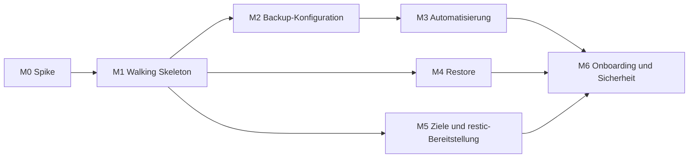

# Backlog

Meilensteine des MVP mit Stories und Akzeptanzkriterien (AC). Das MVP umfasst 38 MVP-Anforderungen aus [requirements.md](requirements.md); alle sind mindestens einem Meilenstein zugeordnet.

## Reihenfolge

M0 → M1 → M2 → M3; M4 und M5 hängen nur von M1 ab und können parallel zu M2/M3 laufen (wobei `M4-S00` Voraussetzung für `M4-S01` und `M5-S01` ist); M6 setzt M2, M3, M4 und M5 voraus und schliesst das MVP ab.

## Meilensteine

| Meilenstein | Ziel | Stories | ACs | Datei |
| --- | --- | --- | --- | --- |
| M0 Spike | Toolchain trägt; Risiken von CXX-Qt, Packaging, Secret Service, i18n und Daemon/Tray geklärt, bevor Feature-Arbeit beginnt. Ergebnis: Wegwerf-Code, festgelegte Versionen, ADR-0001. | 11 | 29 | [milestones/m0-spike.md](milestones/m0-spike.md) |
| M1 Walking Skeleton | Ein Backup läuft durch alle Schichten: GUI → D-Bus → Daemon → restic → Historie → Tray und Notification. Minimal, aber echt und als `.deb` installierbar. | 23 | 102 | [milestones/m1-walking-skeleton.md](milestones/m1-walking-skeleton.md) |
| M2 Backup-Konfiguration | Ein Backup lässt sich vollständig und verständlich konfigurieren: Ausschluss-Regeln (Hauptunterschied zu Déjà Dup), Aufbewahrung mit Vorschau, Quellen-Prüfung. Noch ohne Zeitplan. | 12 | 63 | [milestones/m2-backup-konfiguration.md](milestones/m2-backup-konfiguration.md) |
| M3 Automatisierung | Backups laufen von selbst, zuverlässig und sichtbar: Zeitplan, Laufbedingungen, Neuversuch, Überfälligkeit, Wartung pro Ziel, Ruhezustand. | 14 | 79 | [milestones/m3-automatisierung.md](milestones/m3-automatisierung.md) |
| M4 Restore | Daten kommen sicher zurück: Snapshots sehen, vergleichen, durchsuchen, wiederherstellen, ohne versehentlich zu überschreiben. | 8 | 72 | [milestones/m4-restore.md](milestones/m4-restore.md) |
| M5 Ziele und restic-Bereitstellung | Alle restic-Backends sind nutzbar, und Kestic funktioniert auch dort, wo das System-restic zu alt ist (Ubuntu-24.04-Basis). | 9 | 68 | [milestones/m5-ziele-und-restic.md](milestones/m5-ziele-und-restic.md) |
| M6 Onboarding und Sicherheit | Ein Endnutzer richtet sein erstes Backup in 5 Schritten ein, sichert sein Passwort und kommt auf einem neuen Rechner wieder an seine Daten. Abschluss des MVP. | 12 | 61 | [milestones/m6-onboarding-und-sicherheit.md](milestones/m6-onboarding-und-sicherheit.md) |
| **Total** | | **89** | **474** | |

**Stand 2026-11-26:** M0 bis M4 abgeschlossen und manuell abgenommen; M4 ist als `v0.4.0` veröffentlicht. M5 abgeschlossen auf `m5` (Abschluss-PR nach `main` folgt, manuelle Abnahme offen), M6 offen.

Nach dem MVP: [milestones/nach-mvp.md](milestones/nach-mvp.md) (Phase 2, Luxus, P3). Versionen und Releases: ein Release pro Meilenstein ab M4 (`v0.4.0`), `v1.0.0` nach M6, dazwischen ein Pre-Release pro Merge in `m<n>`; Ablauf in [architecture.md](architecture.md) §Release (Q7).

## Definition of Done

- **Story:** alle ACs der Story als automatisierte Tests grün in `just verify` (Test-Ebenen und Isolation: [test-strategy.md](test-strategy.md)); ACs mit «Test: manuell» in [manual-acceptance.md](manual-acceptance.md) abgehakt.
- **Meilenstein:** alle Stories erledigt, Exit-Kriterien der Meilenstein-Datei erfüllt, manuelle Abnahme des Meilensteins in [manual-acceptance.md](manual-acceptance.md) vollständig; ab M4 bringt der Abschluss-PR nach `main` die Highlights `docs/releases/<tag>.md` ([architecture.md](architecture.md) §Release).

## Format der Akzeptanzkriterien

`AC-M<n>-<story>-<nr>` (Referenzen in Klammern) – *Gegeben* … *wenn* … *dann* … · Test: Unit | Integration | D-Bus | GUI-Smoke | manuell.
