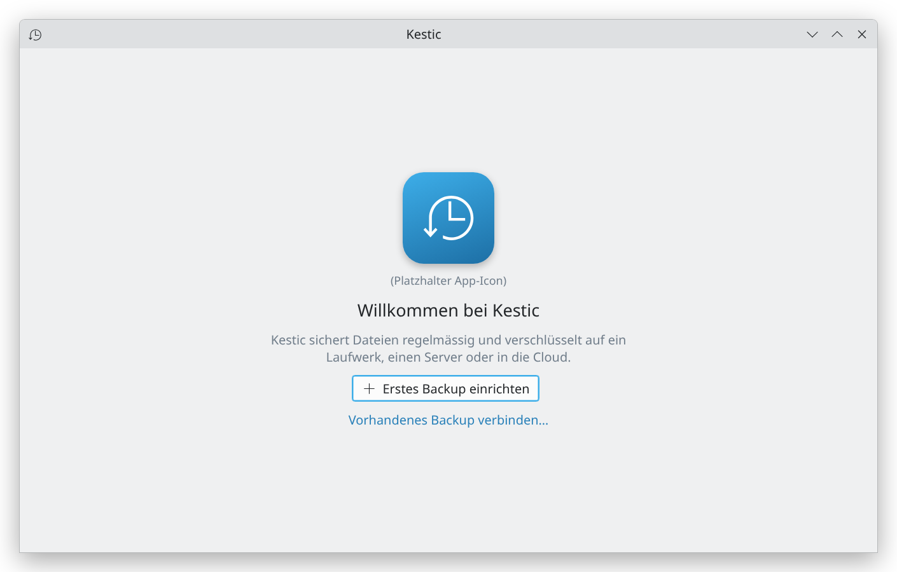
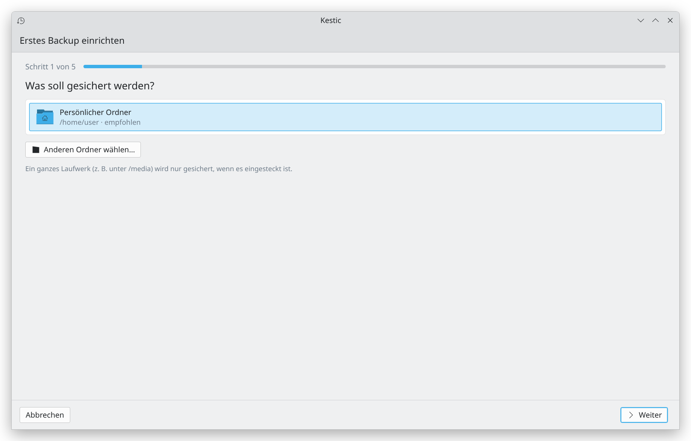
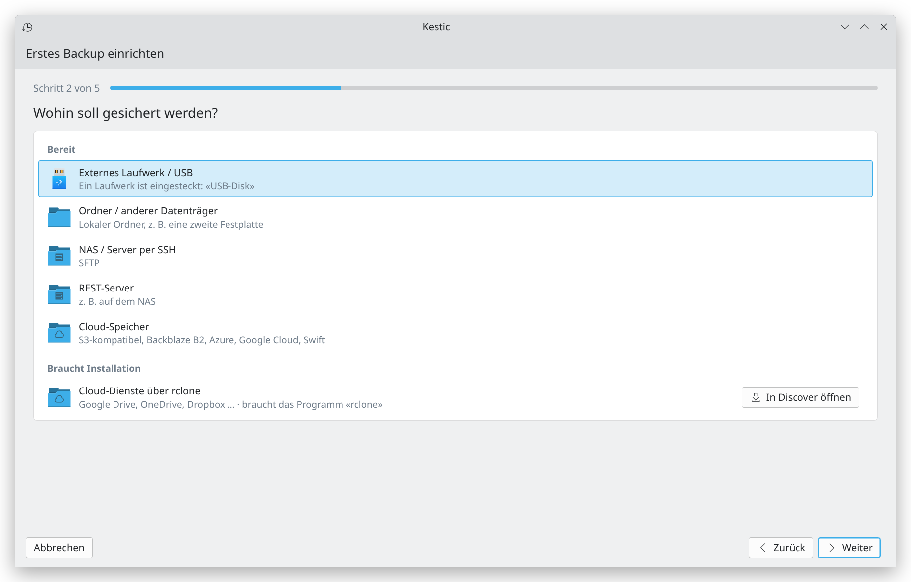
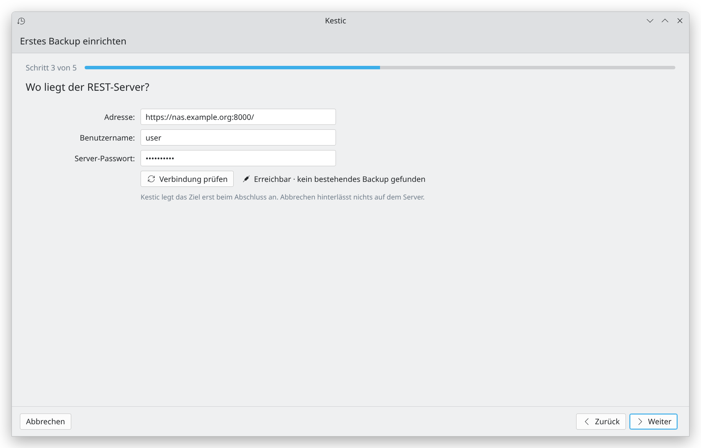
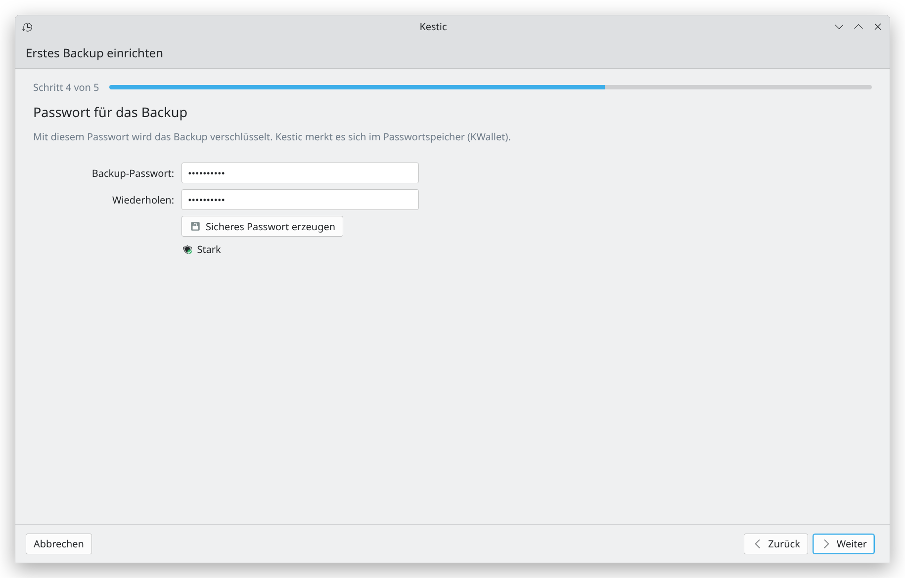
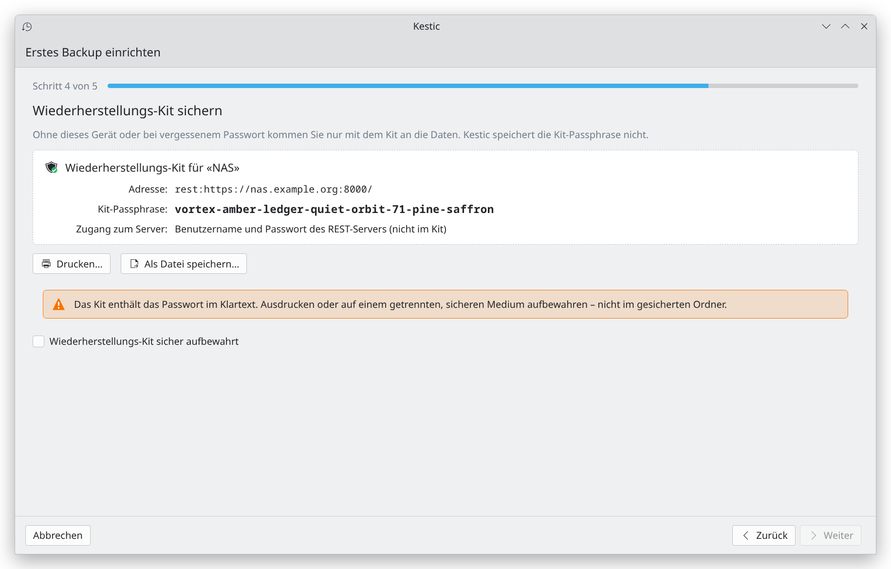
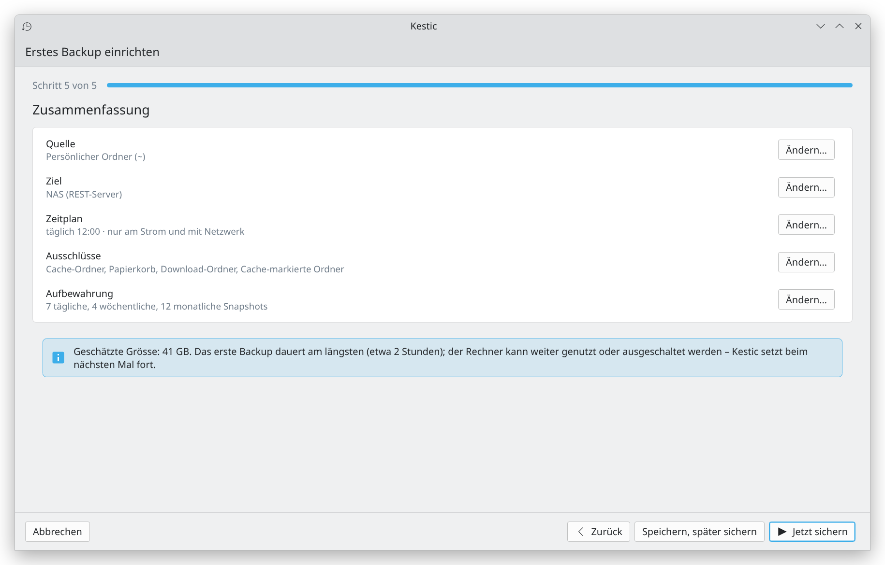
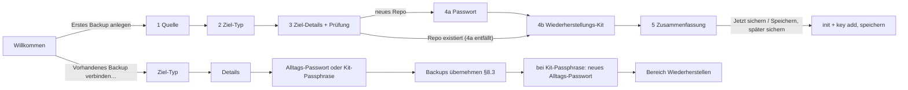
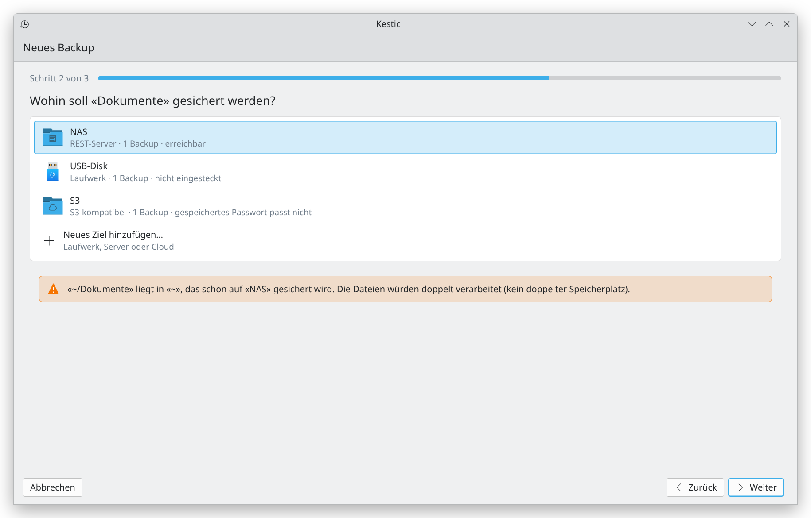
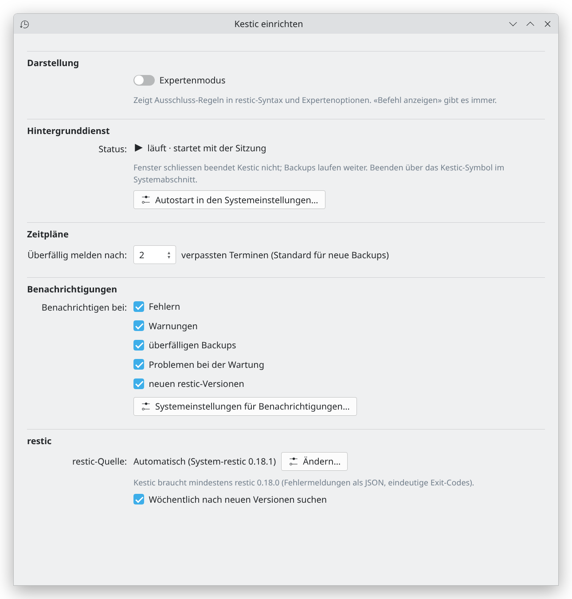

# GUI Abläufe

Teil von [index.md](index.md) (§9). Verbindlichkeit, Referenz-Datensatz (§0.2) und Notation (§0.3): [index.md](index.md). Bilder sind Mockups, nicht normativ.

## 9. Abläufe

### 9.1 Assistent «Erstes Backup anlegen» (FR-38, [architecture.md](../architecture.md) («Onboarding und Ziel-Typen»))

HIG erlaubt einen First-run-Wizard nur für **zwingende** Schritte und ohne Fragen zu optionalen Einstellungen. Ziel, Passwort und Kit sind zwingend; alles Optionale steht als Default in der Zusammenfassung (ändern möglich, nicht verlangt).

**Willkommen** (Startansicht ohne Konfiguration, zentriert): App-Icon (128 px) · «Willkommen bei Kestic» · «Kestic sichert Ihre Dateien regelmässig und verschlüsselt auf ein Laufwerk, einen Server oder in die Cloud.» · `[Erstes Backup anlegen]` (Hauptaktion) · Link «Vorhandenes Backup verbinden…».

**Rahmen jedes Schritts** (lineare Seitenfolge im `pageStack`, vollflächig ohne Tab-Leiste, HIG): Kopfleiste mit dem Namen des Assistenten; «Schritt n von m» + Fortschrittsbalken (m je Ablauf, siehe unten); Frage als Überschrift (Heading), z. B. «Wo liegt der REST-Server?»; Formular, z. B. Adresse, Benutzername, Server-Passwort, `[Verbindung prüfen]` mit Ergebnis daneben («Erreichbar»); Fuss `[Abbrechen]` links, `[Zurück]` `[Weiter]` rechts. `[Weiter]` nur aktiv, wenn gültig; Enter = Weiter; Escape/Abbrechen fragt nur, wenn schon Eingaben gemacht wurden.

| Schritt | Inhalt | Besonderheiten |
| --- | --- | --- |
| 1 Quelle | «Was soll gesichert werden?» – vorausgewählt «Persönlicher Ordner (~)», `[Anderen Ordner wählen…]` | Laufwerk-Erkennung (F10): «Wird nur gesichert, wenn eingesteckt» |
| 2 Ziel-Typ | Liste: Icon, Titel, Kurzbeschreibung; Abschnitte «Bereit» / «Braucht Installation». Ist genau ein Wechseldatenträger eingesteckt, ist «Externes Laufwerk» vorausgewählt | «Braucht Installation»: Erklärung, Paketname, Befehl `sudo apt install <Paket>` zum Kopieren, `[Erneut prüfen]`; `[In Discover öffnen]` (`appstream://`) nur bei Paketen mit AppStream-Komponente (nicht `rclone`, `openssh-client`) |
| 3 Ziel-Details | Formular je Typ (`FormLayout`, Felder §8.9; Label «Server-Passwort»), `[Verbindung prüfen]` | Vorher Zustandsprüfung §6.1 (Passwortspeicher, restic). Erkennt «Repo existiert» → «Vorhandenes Ziel verbinden» (Passwort prüfen). SFTP-Host-Key → §8.7. Generisches Formular: pro Umgebungsvariable Switch «Geheim», Default an bei `KEY`/`SECRET`/`PASSWORD`/`TOKEN` (P22) |
| 4a Passwort | «Mit diesem Passwort wird das Backup verschlüsselt. Kestic merkt es sich im Passwortspeicher.» Felder «Backup-Passwort» + «Wiederholen» oder `[Sicheres Passwort erzeugen]` | entfällt beim Verbinden eines vorhandenen Ziels (Passwort aus Schritt 3) |
| 4b Wiederherstellungs-Kit | «Ohne dieses Gerät oder bei vergessenem Passwort kommen Sie nur mit dem Kit an Ihre Daten.» Kit anzeigen, `[Drucken…]`, `[Als Datei speichern…]`, Pflicht-Checkbox | Passphrase lokal erzeugt (≥ 128 Bit, P25), noch nicht im Repo |
| 5 Zusammenfassung | Quelle, Ziel, Zeitplan (täglich), Ausschlüsse (Cache-Ordner, Papierkorb, Download-Ordner, Cache-markierte Ordner; P29), Aufbewahrung «7 tägliche, 4 wöchentliche, 12 monatliche», je mit `[Ändern…]`; Grössenschätzung (Dry-Run im Hintergrund) und Erwartung erstes Backup | Hauptaktion `[Jetzt sichern]`; zweite `[Speichern, später sichern]` |

**Ziel-Typ (Schritt 2) → Formular (§8.9):**

| Karte | Formular | Hinweis |
| --- | --- | --- |
| Externes Laufwerk / USB | Laufwerk | Wechseldatenträger aus UDisks2 |
| Ordner / anderer Datenträger | Lokal / Ordner | liegt der Ordner auf einem Wechseldatenträger, wird das Ziel als Laufwerk geführt |
| NAS / Server per SSH | SFTP | – |
| REST-Server | REST-Server | – |
| Cloud-Speicher | Unterauswahl: S3-kompatibel → S3; Backblaze B2, Azure, Google Cloud, Swift → Generisch mit vorausgefülltem Schema | – |
| Cloud-Dienste über rclone («Braucht Installation») | Generisch mit Schema `rclone:` und Feld «rclone-Remote» | erst nach Installation von `rclone` wählbar |

**Schrittzählung je Ablauf** (entfallene Schritte zählen nicht mit):

| Ablauf | Schritte |
| --- | --- |
| Erstes Backup anlegen | 5: Quelle · Ziel-Typ · Ziel-Details · Passwort und Kit (4a, 4b; bei vorhandenem Repo nur 4b) · Zusammenfassung |
| Neues Backup (§9.2) | 3: Quelle · Ziel · Zusammenfassung |
| Ziel hinzufügen (§9.3) | 4: Ziel-Typ · Ziel-Details · Passwort · Kit (bei vorhandenem Repo 3) |
| Vorhandenes Backup verbinden | 4: Ziel-Typ · Details · Passwort oder Kit-Passphrase · Backups übernehmen; bei Kit-Passphrase 5 (neues Alltags-Passwort) |

- **Erst beim Abschluss** (Schritt 5) legt Kestic Repo (`init`) und Recovery-Key (`key add` mit der Passphrase aus 4b) an und speichert Passwort und Konfiguration. Abbruch vorher hinterlässt nichts im Ziel. Scheitert `key add` beim Abschluss, versucht Kestic es mit **derselben** Passphrase erneut (Kit bleibt gültig) und meldet sonst klar, dass das Kit noch nicht aktiv ist (Ziel-Detail zeigt «Kit fehlt»).
- **Neuer Rechner** («Vorhandenes Backup verbinden…», FR-39, FR-49, F7): Ziel-Typ → Details → Alltags-Passwort **oder** Kit-Passphrase → Backups übernehmen (§8.3) → bei Kit-Passphrase neues Alltags-Passwort (F7) und Angebot, das alte zu entfernen → Bereich «Wiederherstellen».

### 9.2 Assistent «Neues Backup» (FR-28, FR-31)

Lineare Seitenfolge, vollflächig ohne Tab-Leiste (wie alle Assistenten): (1) Quelle wählen · (2) Ziel: Liste der bestehenden Ziele (vorausgewählt: das einzige bzw. zuletzt benutzte) + «Neues Ziel hinzufügen…» (→ §9.3, danach zurück) · (3) Zusammenfassung mit Defaults wie §9.1 Schritt 5 und Name (Default: Ordnername). Verschachtelte Quelle auf dasselbe Ziel (FR-31) → `InlineMessage` (Warning) in Schritt 1 bzw. 3, nur Hinweis. Abschluss `[Jetzt sichern]` / `[Speichern, später sichern]`.

### 9.3 Assistent «Ziel hinzufügen» (FR-01, FR-15, FR-35)

= Schritte 2, 3, 4a, 4b aus §9.1 mit Abschluss `[Ziel speichern]`; Repo/Keys werden erst dort angelegt.

### 9.4 Fehler mit Handlung (FR-37)

Muster (GUI, Benachrichtigung, Verlauf), HIG-Reihenfolge: **Was ist passiert** (ein Satz, Glossar) · **Ursache** mit **Herkunft** (restic, Server, Netzwerk – nicht Kestic beschuldigen) · **Handlung** als Knopf. Rohmeldung unter «Details» einklappbar. Unbekannter Exit-Code: «Unbekannter Fehler (Exit n)» + Rohmeldung (P6). Nie nur Beschreibung, nie nur Rohtext, nie still.

> «Backup ‹Projekte› fehlgeschlagen: Der S3-Speicher hat das gespeicherte Passwort abgelehnt.» `[Gespeichertes Passwort aktualisieren…]` `[Details]`

### 9.5 Kestic beenden (NFR-11)

Nur im Tray «Kestic beenden…» → `PromptDialog` «Kestic beenden?»: «Geplante Backups laufen erst wieder, wenn Kestic gestartet ist.» `[Abbrechen]` `[Kestic beenden]`. Läuft ein Lauf: zusätzlich «Das laufende Backup ‹…› wird abgebrochen.» Kein anderer Weg beendet den Daemon (auch keine Benachrichtigungs-Aktion).

### 9.6 Einstellungen (U3)

Eigenes Fenster «Kestic einrichten», **eine** `FormLayout`-Seite mit Abschnitten. Änderungen wirken sofort (HIG), ausser Aktionen mit Folgen (Download, Umstellen der restic-Quelle): diese nur über Knopf.

| Abschnitt | Inhalt |
| --- | --- |
| Darstellung | `Expertenmodus` (Switch) mit Erklärsatz, was zusätzlich erscheint (E16, K2) |
| Hintergrunddienst | Status «läuft · startet mit der Sitzung»; dauerhafter Hinweis «Fenster schliessen beendet Kestic nicht; Backups laufen weiter. Beenden über das Kestic-Symbol im Systemabschnitt.» (U9); `[Autostart in den Systemeinstellungen…]` |
| Zeitpläne | Standard «überfällig nach n verpassten Terminen». Globale Pause nicht hier, sondern im Hamburger-Menü/Tray, Anzeige in der Zustandsleiste |
| Benachrichtigungen | Checkboxen je Ereignis-Art (F3): Fehler, Warnungen, überfällig, Wartungsprobleme, restic-Updates; `[Systemeinstellungen für Benachrichtigungen…]` |
| restic | Anzeige «restic-Quelle: Automatisch (System-restic 0.18.1)», beide Versionen, Erklärsatz «warum 0.18.0»; `[restic-Quelle ändern…]` (Dialog mit Automatisch · System · Von Kestic verwaltet · Eigener Pfad; Umstellen/Download erst mit `[Übernehmen]`), `[Jetzt aktualisieren]`, `[✓] Wöchentlich nach neuen Versionen suchen` (FR-33, FR-51, P23) |

«Über Kestic» im Hamburger-Menü und über die Versionszeile im Tray (§10.1; ohne offene GUI startet der Daemon `kestic --show-about`): eigenes Dialogfenster «Über Kestic» wie «Kestic einrichten», nicht als Spalte im Hauptfenster; darin `Kirigami.AboutPage` ohne eigene Kopfleiste, inkl. restic-Version, unten `[Schliessen]`. Esc schliesst es, danach ist das Hauptfenster wieder aktiv und der Fokus steht, wo er war (z. B. auf `☰`). Ist es schon offen, kommt es nach vorn. Autor nur mit Namen, ohne E-Mail-Adresse. Sprache, Farben, Schrift folgen dem System.

- **Version:** Kopf «Kestic 0.1.0» mit der Version der Anwendung (GUI). Abschnitt «Version» mit zwei Zeilen «Anwendung: 0.1.0 · a561018» und «Hintergrunddienst: 0.1.0 · a561018» (Version und kurzer Git-Hash des Builds, wie in der Startzeile des Daemons). Ein sauberer Hash ist ein Link auf `https://github.com/Swissbite/kestic/commit/<hash>` (Name für Screenreader «Quellcode a561018»); `-dirty` steht ohne Link, `unknown` entfällt. Ist der Hintergrunddienst nicht erreichbar: «nicht verfügbar».
- **Anderer Build:** Weichen Version oder (bei beiden bekanntem Hash) Commit von Anwendung und Hintergrunddienst ab, etwa weil der Daemon nach einem Paket-Update per `exec` neu gestartet ist und das offene Fenster noch die alte Version ausführt, steht oben ein Hinweis (Information): «Der Hintergrunddienst läuft in einer anderen Version. Kestic schliessen und neu öffnen, um die neue Version zu laden.» Ohne erreichbaren Daemon oder ohne Hash (älterer Daemon) zählt nur die Version.
- **Links:** Homepage `https://swissbite.github.io/kestic/`; «Ein Problem melden» → `https://github.com/Swissbite/kestic/issues`.
