# GUI Hauptbereiche

Teil von [index.md](index.md) (§7). Verbindlichkeit, Referenz-Datensatz (§0.2) und Notation (§0.3): [index.md](index.md). Bilder sind Mockups, nicht normativ. Seitentitel, Breadcrumb und Hamburger-Menü nach §4.1.

## 7. Hauptbereiche

### 7.1 Übersicht

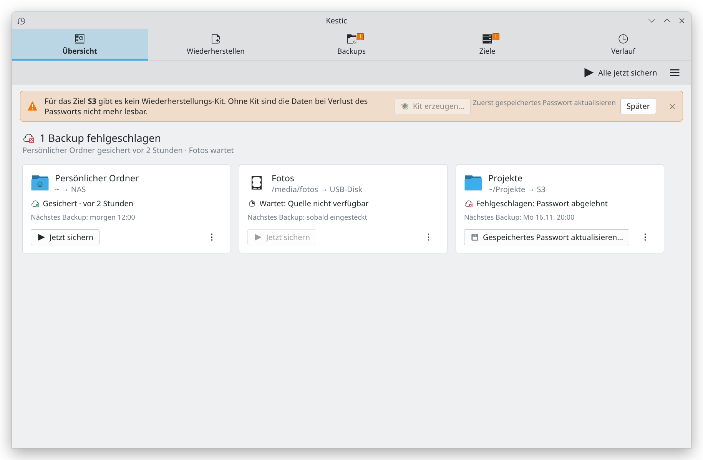
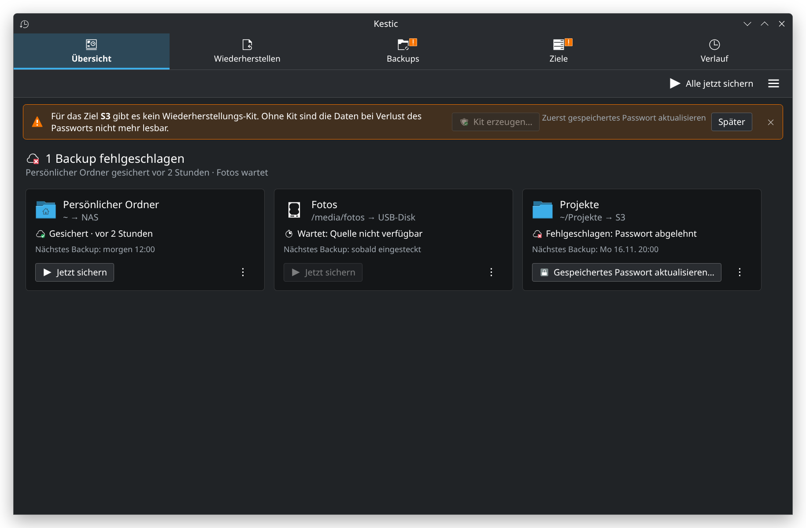
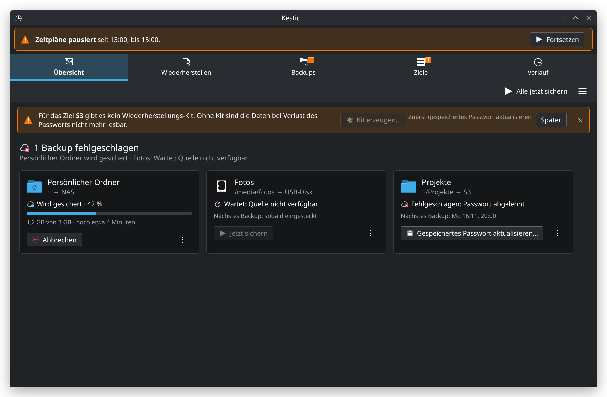

Aufbau:
- Kopfleiste: kein Titel; Aktionen `[▶ Alle jetzt sichern]`, `☰`.
- `InlineMessage` (Warning): «Für das Ziel ‹S3› gibt es kein Wiederherstellungs-Kit. Ohne Kit sind die Daten bei Verlust des Passworts nicht mehr lesbar.» `[Kit erzeugen…]` (im Datensatz deaktiviert, Zusatz «Zuerst gespeichertes Passwort aktualisieren», §8.2) `[Später]` `×`.
- Überschrift (Heading 1): Status-Icon + Gesamtstatus «1 Backup fehlgeschlagen»; Untertitel «Persönlicher Ordner gesichert vor 2 Stunden · Fotos wartet».
- Karten, eine pro Backup: Icon nach Quellentyp, Name, «Quelle → Ziel», Statuszeile (Icon + Text, §6.2), «Nächstes Backup: …», Hauptknopf, `⋮`. Im Datensatz:
  - Persönlicher Ordner · `~ → NAS` · Gesichert · vor 2 Stunden · Nächstes Backup: morgen 12:00 · `[▶ Jetzt sichern]`
  - Fotos · `/media/fotos → USB-Disk` · Wartet: Quelle nicht verfügbar · Nächstes Backup: sobald eingesteckt · `[▶ Jetzt sichern]` deaktiviert (Grund steht in der Statuszeile, §7.2)
  - Projekte · `~/Projekte → S3` · Fehlgeschlagen: Passwort abgelehnt · Nächstes Backup: Mo 16.11. 20:00 · `[Gespeichertes Passwort aktualisieren…]`

Regeln:
- Karten (`Kirigami.Card`/`CardsLayout`) nur hier: heterogene Infos + Aktion pro Backup. Sonst Listen.
- Läuft ein Backup: Karte zeigt `ProgressBar`, «42 % · 1,2 GB von 3 GB · noch etwa 4 Minuten» (P5) und `[■ Abbrechen]` statt «Jetzt sichern».
- **Keine Doppelmeldung:** Fehler und Überfälligkeit eines Backups stehen nur auf seiner Karte (Statuszeile + Handlungsknopf), die Überschrift fasst zusammen. `InlineMessage`s nur für Themen ohne Karte: Kit fehlt, restic-Update verfügbar (Information, `[Aktualisieren…]`, F20); blockierende Zustände in der Zustandsleiste (§6.1).
- **Dauerhafter Fehler** (z. B. Exit 12, F2): Der Handlungsknopf aus FR-37 ersetzt «Jetzt sichern» auf Karte und im Detail («Gespeichertes Passwort aktualisieren…»); «Trotzdem jetzt sichern» bleibt im `⋮`-Menü.
- **«Alle jetzt sichern»** startet alle Backups, die laufen können, und überspringt die anderen mit einer Meldung (`showPassiveNotification`, auch im Verlauf): «2 Backups übersprungen: Fotos (Quelle nicht verfügbar), Projekte (gespeichertes Passwort passt nicht)». Gleiches im Tray.
- Kit-Hinweis: «Später» und «×» blenden ihn für 7 Tage aus, danach wieder; im Ziel-Detail bleibt er dauerhaft sichtbar. Ausnahme: «Kit fehlt» nach einem umgezogenen Repository (§8.9, Fall 2) hat kein «Später» und kein «×».
- Leer: Willkommensseite (§9.1).

### 7.2 Backups: Liste und Detail

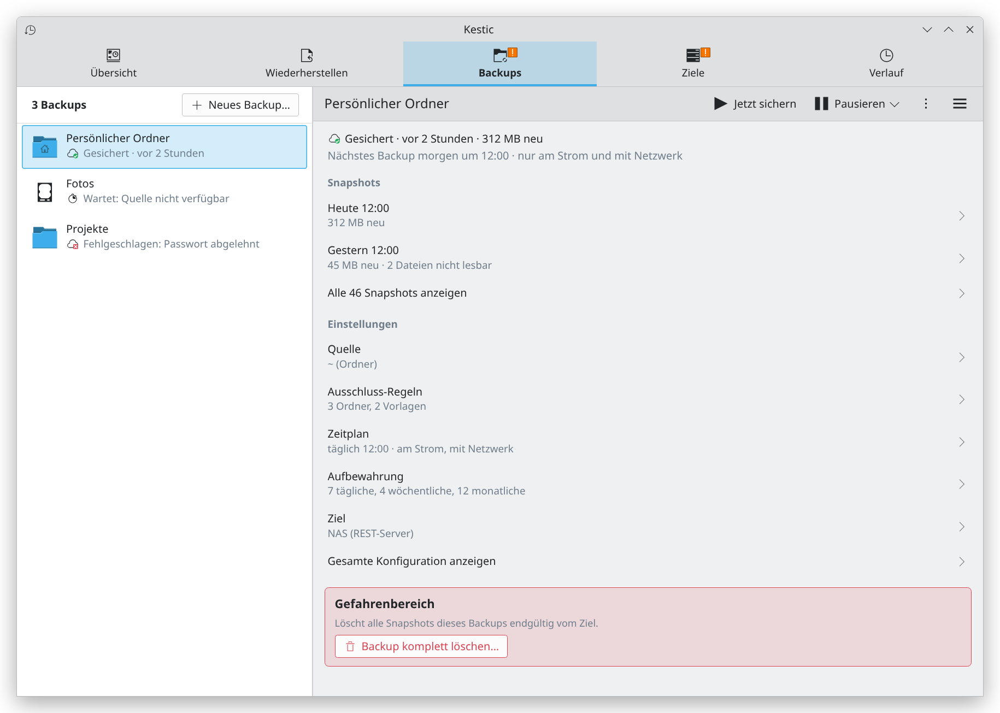
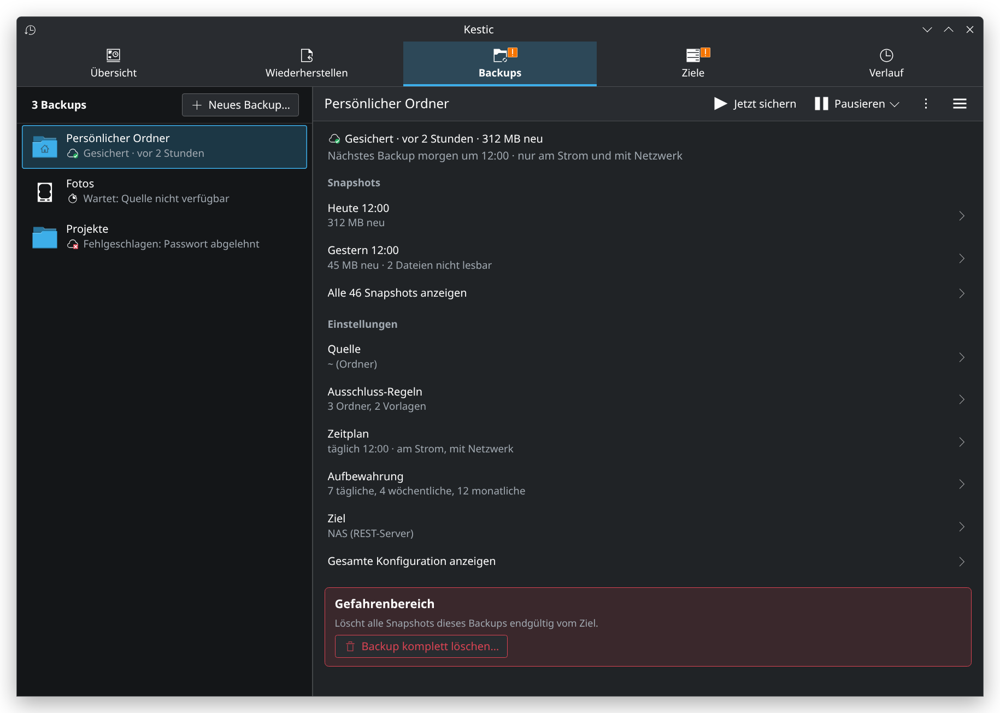

Aufbau Liste (linke Spalte, ohne Kopfleistentitel):
- `InlineViewHeader`: «3 Backups» `[+ Neues Backup…]`.
- Zeile je Backup: Icon nach Quellentyp (`user-home`, `folder`, `drive-harddisk`), Name, Statustext als zweite Zeile, Status-Icon; Kontextmenü (Rechtsklick, Menü-Taste) = `⋮`-Einträge.

Aufbau Detail (rechte Spalte), Titel «Persönlicher Ordner», Aktionen `[▶ Jetzt sichern]` `[⏸ Pausieren ▾]` `⋮` `☰`:
- Statuszeile «Gesichert · vor 2 Stunden · 312 MB neu»; darunter «Nächstes Backup morgen um 12:00 · nur am Strom und mit Netzwerk».
- Abschnitt **Snapshots:** «Heute 12:00 · 312 MB neu ›», «Gestern 12:00 · 45 MB neu ›», «Alle 46 Snapshots anzeigen ›» (§8.12).
- Abschnitt **Einstellungen** (je Zeile Wert + `›`): Quelle «~ (Ordner)» (§8.10) · Ausschluss-Regeln «3 Ordner, 2 Vorlagen» (§7.3) · Zeitplan «täglich 12:00 · am Strom, mit Netzwerk» (§7.4) · Aufbewahrung «7 tägliche, 4 wöchentliche, 12 monatliche» (§7.5) · Ziel «NAS (REST-Server)» (§8.8) · «Gesamte Konfiguration anzeigen» (§8.11).
- **Gefahrenbereich** (FR-48, P3; EN «Danger Zone»): abgesetzter Abschnitt am Seitenende mit negativem Hintergrund, `[Backup komplett löschen…]`; nie im `⋮`-Menü.

Regeln:
- **`⋮`:** «Vorschau: Was würde gesichert?» (FR-17), «Umbenennen…» (`PromptDialog` mit Textfeld), «Befehl anzeigen» (FR-34), «Aus Kestic entfernen…» (§12.3).
- Fehler → `InlineMessage` (Error) mit Text aus FR-37 und Handlung, z. B. «Gespeichertes Passwort aktualisieren…» (§8.4), «Erneut versuchen», «Sperre aufheben…» (§8.5).
- Verschachtelte Quellen (FR-31) → `InlineMessage` (Warning) in beiden Backups, nur Hinweis (P9).
- **Pausieren ▾:** «1 Stunde», «3 Stunden», «Bis morgen», «Bis ich fortsetze» (FR-13a). Pausiert → `[▶ Fortsetzen]`, Status «Pausiert seit … (bis …)».
- **«Jetzt sichern» bei nicht erfüllten Laufbedingungen** (FR-13b): `PromptDialog` «Trotzdem jetzt sichern?» – «Bedingung nicht erfüllt: am Strom (Akku 34 %).» `[Abbrechen]` `[Trotzdem sichern]`.
- **Quelle oder Ziel nicht verfügbar** (FR-30, FR-29 verweist darauf): «Jetzt sichern» ist überall (Karte, Detail, Tray) **deaktiviert**; der Grund steht sichtbar in der Statuszeile («Wartet: Quelle nicht verfügbar») und zusätzlich im Tooltip (HIG: nie nur Tooltip). Ändert sich der Zustand zwischen Anzeige und Klick, meldet Kestic sofort (Ereignis `ManualRunBlocked`). Grundlage ist der Verfügbarkeitsstatus im Daemon: Quelle über Mount- und UDisks2-Ereignisse, Ziel über den letzten Vorab-Check; erneuert bei Netzwerkwechsel und beim Öffnen von Fenster oder Tray-Menü, höchstens alle 60 Sekunden (AC-M3-04-11).

### 7.3 Ausschluss-Regeln (FR-02, F12, M2)

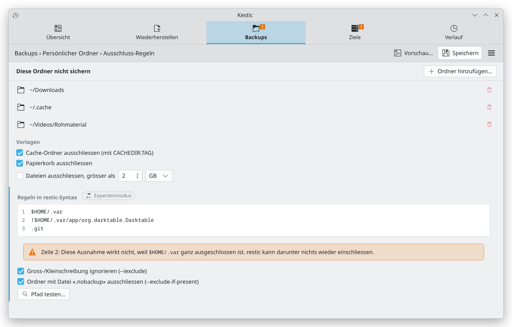

Aufbau, Breadcrumb «Backups › Persönlicher Ordner › Ausschluss-Regeln», Aktionen `[Vorschau…]` `[Speichern]`:
- `InlineViewHeader` «Diese Ordner nicht sichern» `[+ Ordner hinzufügen…]`; Liste mit `[🗑]` je Zeile: `~/Downloads`, `~/.cache`, `~/Videos/Rohmaterial`.
- Abschnitt **Vorlagen:** `[✓]` Cache-Ordner ausschliessen (mit CACHEDIR.TAG) · `[✓]` Papierkorb ausschliessen · `[ ]` Dateien ausschliessen, grösser als `[2]` `[GB ▾]`.
- Einfacher Modus: Zeile «ⓘ 3 weitere Regeln in restic-Syntax. Zum Bearbeiten Expertenmodus einschalten…».
- **Expertenmodus** (zusätzlicher Abschnitt derselben Seite, K2): «Regeln in restic-Syntax (Globs, `**`, `!`Ausnahme, `$VAR`; kein Regex)» ⓘ; Code-Eingabe mit Zeilennummern, Beispiel: 1 `$HOME/.var` · 2 `!$HOME/.var/app/org.darktable.Darktable` · 3 `.git`; Hinweis «⚠ Zeile 2: Diese Ausnahme wirkt nicht, weil ‹$HOME/.var› ganz ausgeschlossen ist» (M2-S03); `[✓]` Gross-/Kleinschreibung ignorieren (`--iexclude`); `[✓]` Ordner mit Datei ‹.nobackup› ausschliessen (`--exclude-if-present`); `[Pfad testen…]`.

Regeln:
- Hinweise als `InlineMessage` (Warning) mit Zeilennummer; nur Hinweis, Speichern bleibt möglich (P9). Linter FR-27 (P2) nutzt dieselbe Stelle.
- «Expertenmodus einschalten…» → `PromptDialog` (K2), danach erscheint der Abschnitt.
- «Vorschau…» = Dry-Run (FR-17) als Unterseite: Dateianzahl, Grösse, grösste ausgeschlossene Ordner; abbrechbar.
- «Pfad testen…»: Pfad eingeben → «wird gesichert» / «ausgeschlossen durch Zeile n».
- Ordner-Regeln werden als absolute, verankerte Pfade geschrieben (P8).
- **Explizites Speichern** (U18): Editoren für Backups haben `[Speichern]`; der Zwischenstand lebt nur in der GUI; Speichern = D-Bus-Aufruf `UpdateBackup` (F14), Validierung in `core`. Verlassen mit ungespeicherten Änderungen → `PromptDialog` «Änderungen speichern?» `[Speichern]` `[Verwerfen]` `[Abbrechen]`. `[Speichern]` und `[Schliessen]` stehen nur in der unteren Aktionsleiste der Seite, nicht zusätzlich im Formular (Entscheid 2026-11-20).

### 7.4 Zeitplan und Laufbedingungen (FR-03, FR-13, F1)

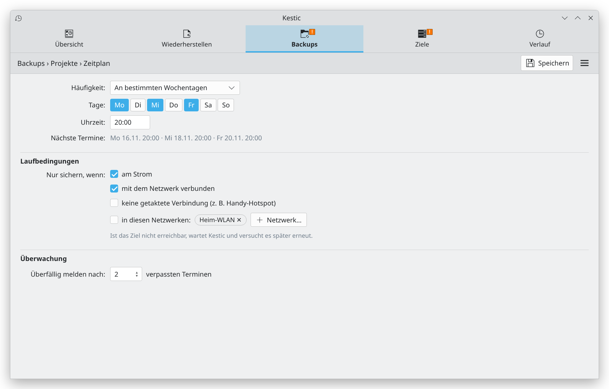

Aufbau (`FormLayout`, rechtsbündige Labels), Breadcrumb «Backups › Projekte › Zeitplan», Aktion `[Speichern]`:
- Häufigkeit: `[An bestimmten Wochentagen ▾]` · Tage: `[Mo]`…`[So]` · Uhrzeit: `[20:00]` · Nächste Termine: «Mo 16.11. 20:00 · Mi 18.11. 20:00 · …».
- Abschnitt **Laufbedingungen** – «Nur sichern, wenn:» `[✓]` am Strom · `[✓]` mit dem Netzwerk verbunden · `[ ]` keine getaktete Verbindung (z. B. Hotspot) · `[ ]` in diesen Netzwerken: `[Heim-WLAN ✕]` `[+ Netzwerk…]`; Hinweis «Ist das Ziel nicht erreichbar, wartet Kestic und versucht es später erneut.»
- Abschnitt **Überwachung** – «Überfällig melden nach: `[2]` verpassten Terminen».

| Häufigkeit (ComboBox) | Felder |
| --- | --- |
| Täglich | Uhrzeit |
| An bestimmten Wochentagen | Tage (Toggle-Knöpfe, mind. einer), Uhrzeit |
| Alle n Tage | «Alle [n] Tage» (SpinBox 2–365), «ab [Datum]» (Datumswähler, Default heute), Uhrzeit |
| Nur manuell | keine; Hinweis «Kestic meldet nie ‹überfällig›» |

- ComboBox statt vier Radios (HIG ≤ 3).
- Netzwerkliste aus NetworkManager (bekannte Verbindungen).

### 7.5 Aufbewahrung (FR-05, M2-S06)

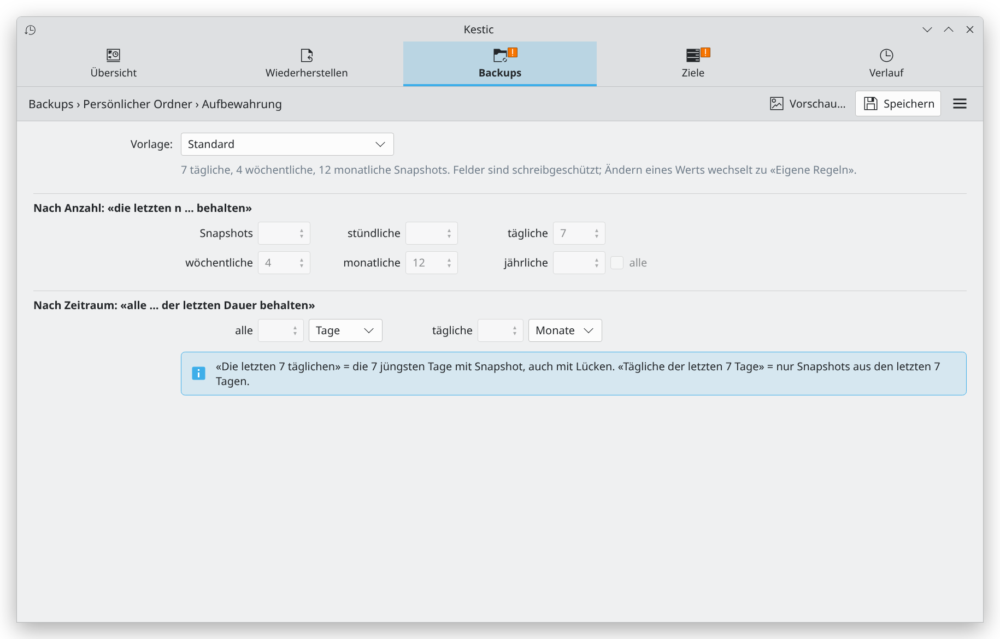

Aufbau, Breadcrumb «Backups › Persönlicher Ordner › Aufbewahrung», Aktionen `[Vorschau…]` `[Speichern]`:
- Vorlage: `[Standard ▾]`, darunter «7 tägliche, 4 wöchentliche, 12 monatliche Snapshots».
- Abschnitt **Nach Anzahl: «die letzten n … behalten»** – SpinBoxes Snapshots, stündliche, tägliche `[7]`, wöchentliche `[4]`, monatliche `[12]`, jährliche (+ `[ ]` alle); bei Vorlage «Standard» schreibgeschützt mit diesen Werten.
- Abschnitt **Nach Zeitraum: «alle … der letzten Dauer behalten»** – alle `[ ]` `[Tage ▾]`, tägliche `[ ]` `[Monate ▾]` usw.
- `InlineMessage` (Information): «‹Die letzten 7 täglichen› = die 7 jüngsten Tage mit Snapshot, auch mit Lücken. ‹Tägliche der letzten 7 Tage› = nur aus den letzten 7 Tagen.»

| Feld | Flag | Eingabe |
| --- | --- | --- |
| Snapshots (Anzahl) | `--keep-last n` | SpinBox, leer = nicht gesetzt |
| stündliche / tägliche / wöchentliche / monatliche / jährliche (Anzahl) | `--keep-hourly/-daily/-weekly/-monthly/-yearly n` | SpinBox + Checkbox «alle» = `unlimited` |
| alle (Zeitraum) | `--keep-within <dauer>` | Zahl + Einheit (Stunden, Tage, Monate, Jahre) → `48h`, `30d`, `6m`, `2y` |
| stündliche / tägliche / … (Zeitraum) | `--keep-within-hourly/-daily/-weekly/-monthly/-yearly <dauer>` | wie oben |

| Vorlage | Regeln |
| --- | --- |
| Standard (Default) | `--keep-daily 7 --keep-weekly 4 --keep-monthly 12` |
| Sparsam | `--keep-daily 7 --keep-weekly 4` |
| Lang | `--keep-daily 7 --keep-weekly 4 --keep-monthly 12 --keep-yearly unlimited` |
| Eigene Regeln | frei |

- Vorlage ≠ «Eigene Regeln» → Felder schreibgeschützt mit den Werten der Vorlage; Ändern eines Felds schaltet auf «Eigene Regeln».
- Validierung: mindestens eine Regel, sonst `InlineMessage` (Error) und `[Speichern]` deaktiviert.
- **Vorschau** (`forget --dry-run`): Tabelle Snapshot · Ergebnis («Behalten» `emblem-ok-symbolic` / «Entfernen» `edit-delete`) · Grund («täglich», «monatlich», «jüngster»).
- **Bestätigung beim Speichern** (P10): würde die Vorschau Snapshots entfernen, `PromptDialog` «n Snapshots werden beim nächsten Lauf endgültig entfernt» mit Liste; sonst ohne Dialog.

### 7.6 Wiederherstellen (FR-06, FR-07, FR-10, FR-36, F5, F6, P18–P20)

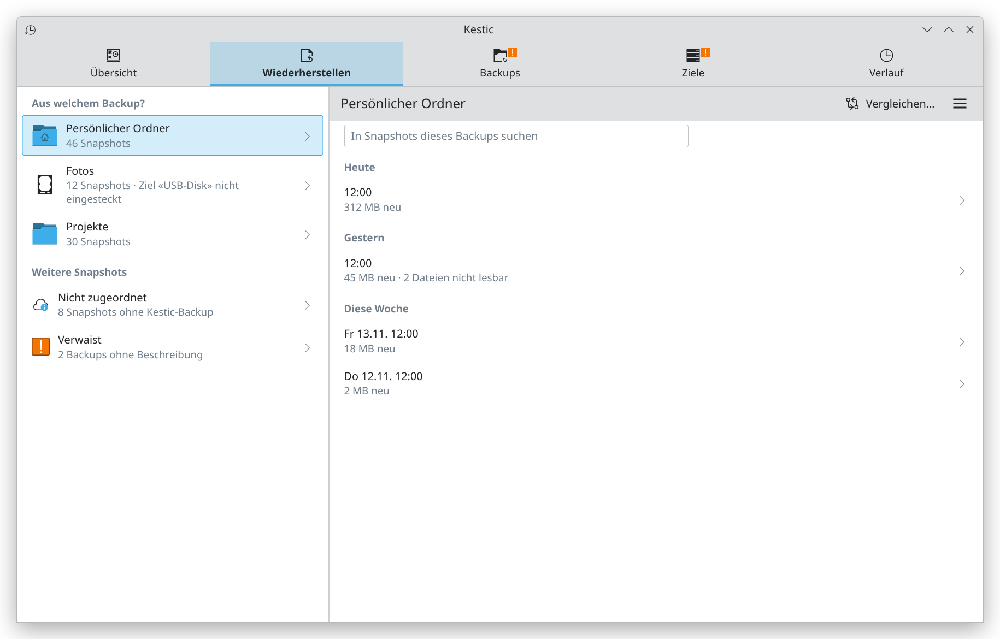
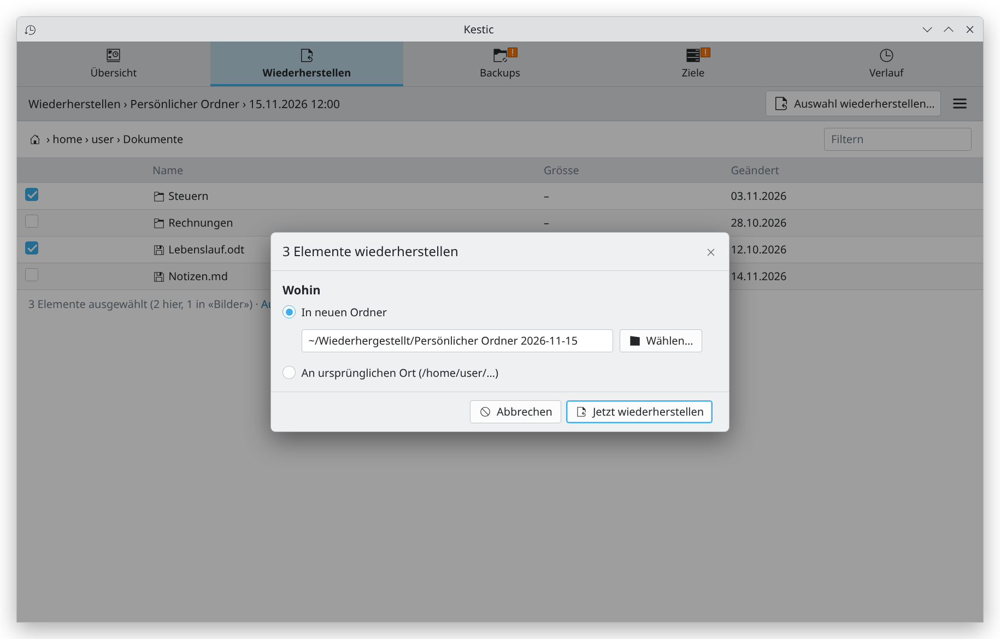
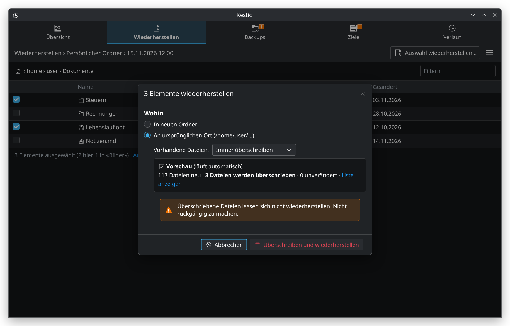
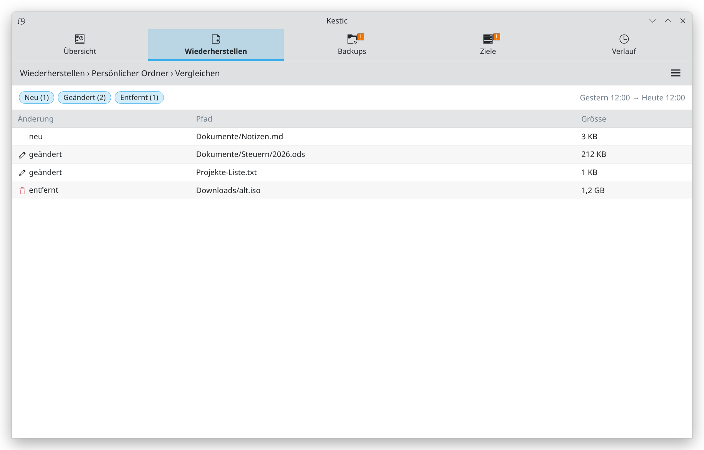
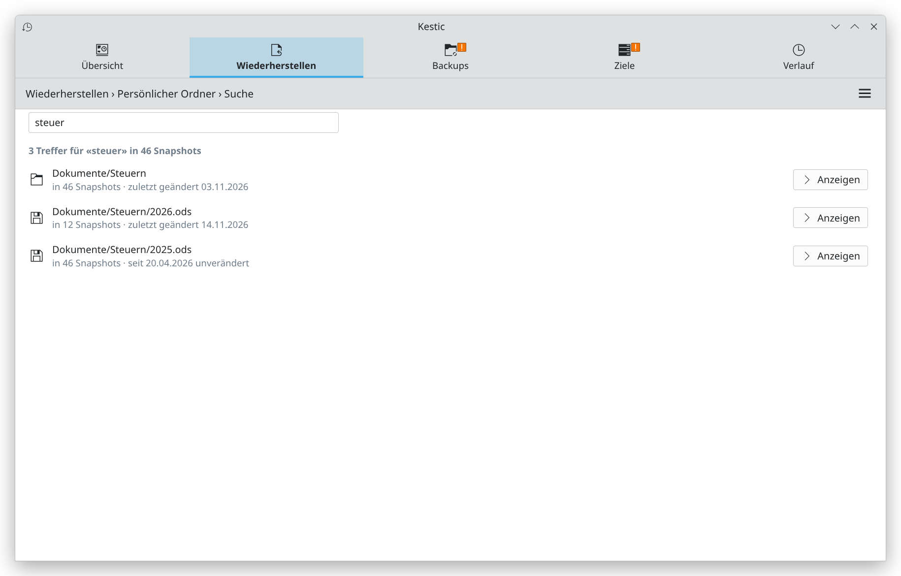
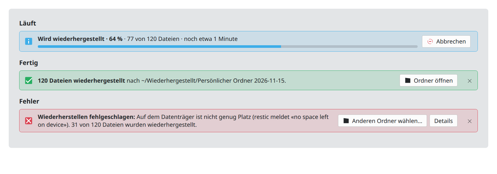

**Snapshot wählen** (zwei Spalten):
- Links «Aus welchem Backup?»: je Backup Name · Anzahl Snapshots · `›` (Persönlicher Ordner 46, Fotos 12, Projekte 30); Abschnitt «Weitere Snapshots»: «Nicht zugeordnet (FR-36) · 8 ›», «Verwaist (FR-49, P20) · 2 ›» (§8.14).
- Rechts Titel «Persönlicher Ordner», Aktion `[Vergleichen…]`: Suchfeld «In Snapshots dieses Backups suchen» (P18); Snapshots nach Datum gruppiert (Heute 12:00 · 312 MB neu; Gestern 12:00 · 45 MB neu; Diese Woche: Mo 09.11. 12:00 …).

**Durchsuchen** (Liste mit Breadcrumb wie die Detailansicht in Dolphin, keine Baumansicht – HIG, U8), Breadcrumb in der Kopfleiste «Wiederherstellen › Persönlicher Ordner › 15.11.2026 12:00», Aktion `[Auswahl wiederherstellen…]`:
- Pfadzeile «⌂ › home › user › Dokumente» + Feld «Filtern».
- Tabelle: Checkbox · Name · Grösse · Geändert (z. B. `[✓]` Steuern · – · 03.11.2026; `[ ]` Lebenslauf.odt · 48 KB · 12.10.2026).
- Auswahlzeile «3 Elemente ausgewählt (2 hier, 1 in ‹Bilder›) · [Auswahl anzeigen] · [Auswahl aufheben]».
- Auswahl bleibt beim Wechsel des Ordners erhalten; «Auswahl anzeigen» listet sie. `[Auswahl wiederherstellen…]` ist ohne Auswahl deaktiviert (Tooltip «Zuerst Dateien oder Ordner auswählen»).

**Dialog «3 Elemente wiederherstellen»** (`Kirigami.Dialog`, eine Ebene; Vorschau inline, kein weiterer Dialog):
- «Wohin»: `(•)` In neuen Ordner `[~/Wiederhergestellt/Persönlicher Ordner 2026-11-15]` `[Wählen…]` · `( )` An ursprünglichen Ort (`/home/user/…`) mit «Vorhandene Dateien: `[Nie überschreiben ▾]`» (Nie · Wenn älter · Wenn verändert · Immer).
- Vorschau (läuft automatisch, Pflicht bei Originalort): z. B. «117 Dateien neu · 3 vorhandene Dateien werden nicht überschrieben» `[Liste ▾]`.
- Fuss: `[Abbrechen]` `[Jetzt wiederherstellen]`.

Regeln:
- Default neuer Ordner (F5); dort keine Vorschau, weil nichts überschrieben wird. Bei «An ursprünglichen Ort» läuft die Vorschau (`--dry-run`) **immer** (AC-M4-05-4); der Knopf ist erst nach der Vorschau aktiv. Vorschautext passt zum Modus: «werden nicht überschrieben» bei «Nie» (Begriff wie AC-M4-05-3), «werden überschrieben» sonst; bei Überschreiben heisst der Knopf «Überschreiben und wiederherstellen» (negativer Stil, Abbrechen ist Default, Hinweis «nicht rückgängig»).
- Der Überschreib-Modus gilt nur für diesen Restore; der Dialog startet immer mit «Nie überschreiben» (P19b).
- Anderer Benutzername (F6): Vorschlag auf `/home/<neu>/…` abgebildet, Hinweis «Original: `/home/<alt>/…`». Fehlt der abgebildete Ordner, ist «An ursprünglichen Ort» erst nach Wahl eines Zielordners möglich; Kestic legt keinen Ordner ungefragt an (P19a).
- Ordnerwahl über den System-Dateidialog (Portal; kein Kestic-Dialog).
- **Ablauf:** Restore ist ein Lauf (Tray, Fortschrittsanzeige, Verlauf). Die Seite zeigt eine `InlineMessage` (Information) mit Fortschritt und `[Abbrechen]`; Ende → `InlineMessage` (Positive) «120 Dateien wiederhergestellt» `[Ordner öffnen]` (Dolphin via `Qt.openUrlExternally`); Fehler → `InlineMessage` (Error) nach §9.4. Endet der Restore mit Fenster im Hintergrund, zusätzlich Systembenachrichtigung (lange Aufgabe, HIG-Ausnahme).
- **Vergleichen:** «Vergleichen…» schaltet die Snapshot-Liste in einen Auswahlmodus (Checkboxen, genau zwei; Leiste «2 von 2 gewählt» + `[Unterschiede anzeigen]` + `[Abbrechen]`); zusätzlich im Kontextmenü eines Snapshots «Mit vorherigem vergleichen». Ergebnis: Tabelle mit Spalte «Änderung» (Icon + Text: neu / geändert / entfernt), Pfad, Grösse; Filter-Chips nach Art mit Anzahl.
- **Suche** (`find`, P18): Ergebnisliste mit Pfad und Snapshot-Datum, `[Anzeigen]` öffnet den Ordner im Snapshot.

### 7.7 Ziele (FR-01, FR-11, FR-15, FR-19, FR-35, FR-45, FR-49)

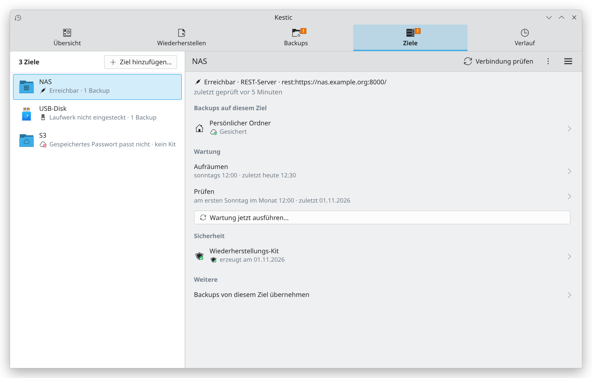

Aufbau Liste: `InlineViewHeader` «3 Ziele» `[+ Ziel hinzufügen…]`; je Ziel Icon nach Typ (Laufwerk `drive-removable-media`, Ordner `folder`, SFTP/REST `network-server`, Cloud `folder-cloud`), Name, Zustand als zweite Zeile (§6.4): NAS «Erreichbar · 1 Backup», USB-Disk «Laufwerk nicht eingesteckt», S3 «Gespeichertes Passwort passt nicht · kein Kit».

Aufbau Detail, Titel «NAS», Aktionen `[Verbindung prüfen]` `⋮` `☰`:
- Statuszeile «Erreichbar · REST-Server · rest:https://…».
- **Backups auf diesem Ziel:** «Persönlicher Ordner · Gesichert ›».
- **Wartung:** «Aufräumen · sonntags 12:00 · zuletzt heute 12:30 ›», «Prüfen · am ersten Sonntag im Monat · zuletzt 01.11. ›» (§8.1), `[Wartung jetzt ausführen…]`.
- **Sicherheit:** «Wiederherstellungs-Kit · erzeugt am 01.11.2026 ›» (§8.2).
- **Weitere:** «Backups von diesem Ziel übernehmen ›» (§8.3).

Regeln:
- `⋮`: «Verbindung bearbeiten…» (§8.9), «Gespeichertes Passwort aktualisieren…» (§8.4), «Sperre aufheben…» (nur bei veralteter Sperre, §8.5), «Befehl anzeigen» (FR-34), «Ziel entfernen…» (§12.3; deaktiviert mit Tooltip, solange Backups darauf zeigen, §8.8).
- «Wartung jetzt ausführen…» → `PromptDialog` mit Vorschau (wie §8.1), da `forget`/`prune` Daten endgültig entfernen.
- Im Expertenmodus zeigt «Wartung» die restic-Begriffe in Klammern (`prune`, `check`) und Expertenoptionen (FR-47, P2).

### 7.8 Verlauf (FR-18, FR-34, F4)

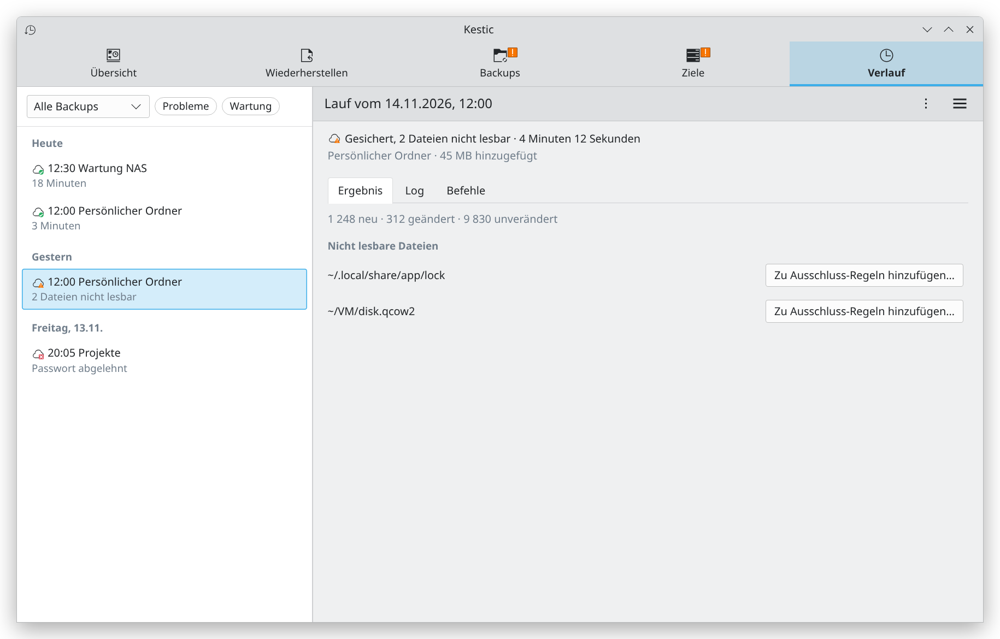

Aufbau Liste: Filter `[Alle Backups ▾]` + checkable `Kirigami.Chip`s «Probleme», «Wartung»; Suchfeld; Läufe nach Tag gruppiert, Zeile = Status-Icon · Uhrzeit · Backup bzw. «Wartung ‹Ziel›» · zweite Zeile Dauer oder Kurzstatus (Heute: 12:30 Wartung NAS · 18 Minuten; 12:00 Persönlicher Ordner · 3 Minuten. Gestern: 12:00 Persönlicher Ordner · 2 Dateien nicht lesbar. Freitag, 13.11.: 20:05 Projekte · Passwort abgelehnt).

Aufbau Detail, Titel «Lauf vom 14.11.2026, 12:00», Aktionen `⋮` `☰`:
- Statuszeile «Gesichert, 2 Dateien nicht lesbar · 4 Minuten 12 Sekunden»; darunter «Persönlicher Ordner · 45 MB hinzugefügt». Keine zweite Zusammenfassung.
- Feste Tabs (`QQC2.TabBar`, vom Benutzer nicht schliess- oder verschiebbar, «immutable tabs» der HIG):
  - **Ergebnis:** «1 248 neu · 312 geändert · …»; «Nicht lesbare Dateien» mit `[Zu Ausschluss-Regeln hinzufügen…]` je Datei (`~/.local/share/…/lock`, `~/VM/disk.qcow2`).
  - **Log** (§8.13).
  - **Befehle** (FR-34, für alle): Aufruf, z. B. `nice -n 10 ionice -c 3 /usr/bin/restic backup …`, «Exit 3 · 4 Minuten 12 Sekunden», `[Kopieren]`.

Lauf-Arten ([glossary.md](../glossary.md)), gleiche Seite mit festen Tabs Ergebnis · Log · Befehle:

| Lauf-Art | Listenzeile / Titel | Statuszeile | Tab «Ergebnis» |
| --- | --- | --- | --- |
| Backup | «12:00 Persönlicher Ordner» / «Lauf vom 14.11.2026, 12:00» | Backup-Zustand (§6.2) + Dauer; darunter Backup · hinzugefügte Datenmenge | neu · geändert · unverändert; nicht lesbare Dateien mit `[Zu Ausschluss-Regeln hinzufügen…]` |
| Wartung | «12:30 Wartung NAS» / «Wartung vom 15.11.2026, 12:30» | «Aufgeräumt und geprüft · 18 Minuten» bzw. Fehler (§6.4) | je Backup entfernte Snapshots, freigegebener Platz, Ergebnis der Prüfung |
| Restore | «14:10 Wiederherstellung Persönlicher Ordner» bzw. ohne Backup-Bezug (nicht zugeordneter oder verwaister Snapshot) «14:10 Wiederherstellung von NAS» / «Wiederherstellung vom 15.11.2026, 14:10» | «120 Dateien wiederhergestellt · 2 Minuten» bzw. Fehler | Zielordner `[Ordner öffnen]`, Anzahl neu / überschrieben / nicht überschrieben |
| Metadaten | «Backup-Beschreibung gespeichert» / «Beschreibung vom …» | «Gespeichert» bzw. «ausstehend» (FR-49) | betroffenes Backup und Ziel |

Regeln:
- **«Zu Ausschluss-Regeln hinzufügen…»** (F4) → `PromptDialog`: zeigt die Regel, die entsteht (Ordner → Ordner-Regel; Datei → Expertenregel mit absolutem Pfad, auch ohne Expertenmodus sichtbar als «weitere Regel»), Folge «Wird ab dem nächsten Backup nicht mehr gesichert. Bestehende Snapshots bleiben unverändert.» `[Abbrechen]` `[Hinzufügen und speichern]` (speichert sofort = `UpdateBackup`).
