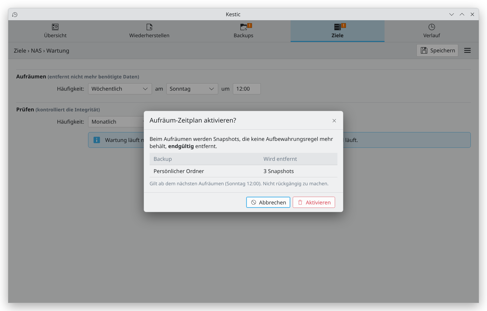
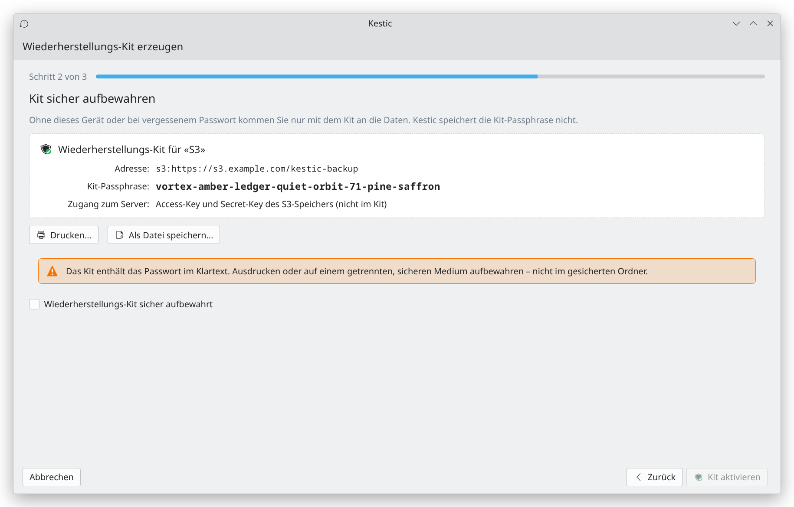
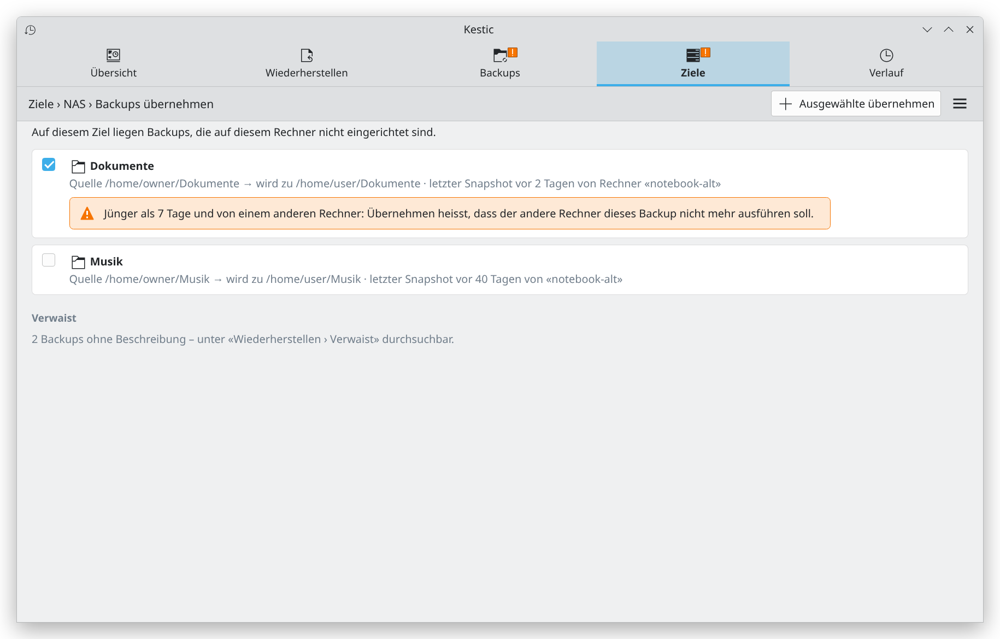
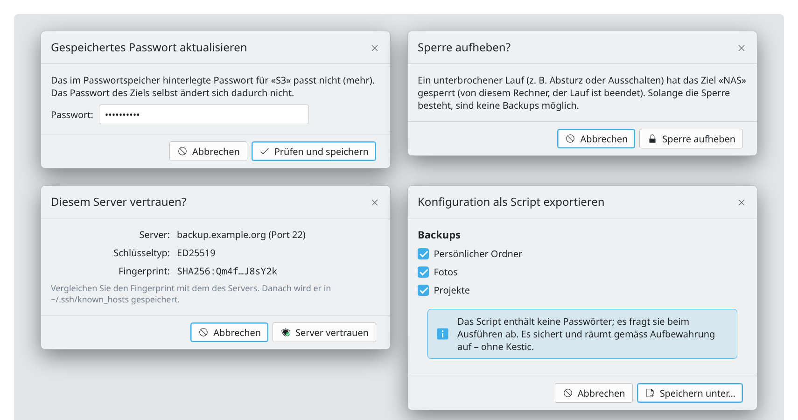
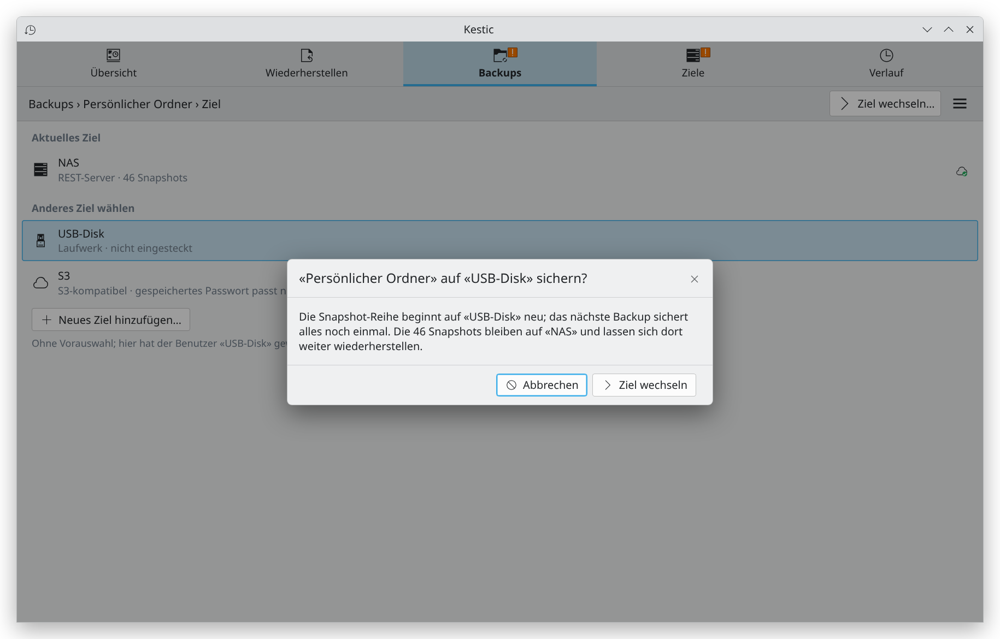
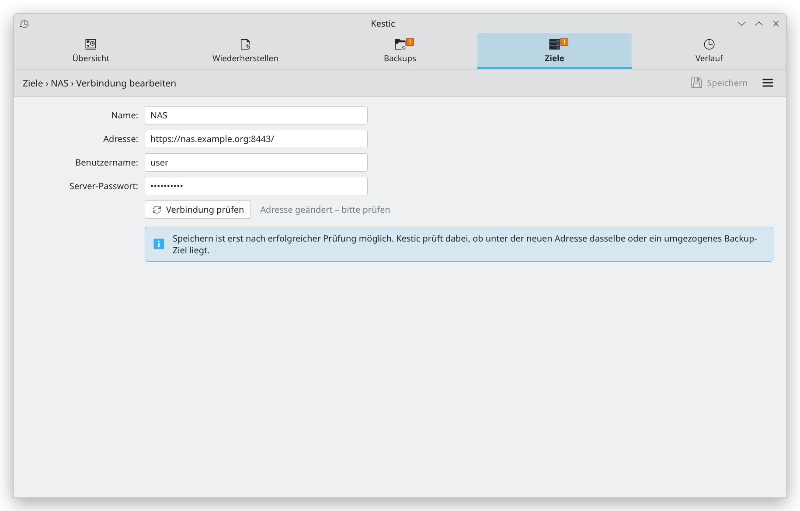
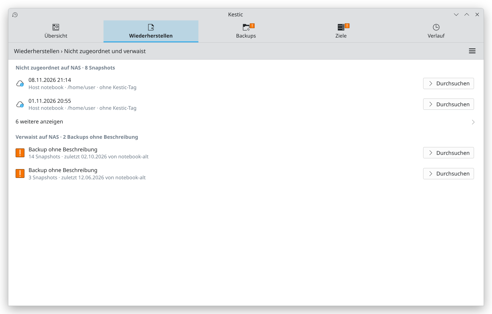

# GUI Nebenseiten

Teil von [index.md](index.md) (§8). Verbindlichkeit, Referenz-Datensatz (§0.2) und Notation (§0.3): [index.md](index.md). Bilder sind Mockups, nicht normativ. Unterseiten zeigen den Breadcrumb statt eines Titels (§4.1).

## 8. Detail- und Nebenseiten

### 8.1 Wartung bearbeiten (FR-45, FR-11, F11, P10, P15)

Aufbau, Breadcrumb «Ziele › NAS › Wartung», Aktion `[Speichern]`:
- Abschnitt **Aufräumen** (entfernt nicht mehr benötigte Daten): Häufigkeit `[Wöchentlich ▾]` · Tag `[Sonntag ▾]` · um `[12:00]`.
- Abschnitt **Prüfen** (kontrolliert die Integrität): Häufigkeit `[Monatlich ▾]` · am `[ersten Sonntag ▾]` · um `[12:00]`.
- Hinweis «Wartung läuft nur am Strom, ohne getaktete Verbindung und wenn kein Backup auf diesem Ziel läuft.»

Regeln:
- Defaults P15. **Bestätigung** (P10): beim Aktivieren oder Ändern des Aufräum-Zeitplans einmalig `PromptDialog` «Beim Aufräumen werden Snapshots, die keine Aufbewahrungsregel mehr behält, endgültig entfernt.» mit Vorschau-Zusammenfassung je Backup («Persönlicher Ordner: 3 Snapshots»).
- Gleicher Dialog bei «Wartung jetzt ausführen…».

### 8.2 Wiederherstellungs-Kit (FR-35, F8, P25–P26)

Seite «Wiederherstellungs-Kit»: Statuszeile «Kit vorhanden · erzeugt am 01.11.2026 · Key-ID 4f2a9c…»; Erklärung «Mit dem Kit lassen sich die Daten auch ohne dieses Gerät und ohne das Alltags-Passwort lesen. Kestic speichert die Kit-Passphrase nicht.»; `[Kit erneuern…]` mit «Erzeugt ein neues Kit; das bisherige wird danach ungültig.»

- Ohne Kit: `PlaceholderMessage` «Kein Wiederherstellungs-Kit» + `[Kit erzeugen…]`.
- «Kit erzeugen/erneuern» braucht Zugriff auf das Repo (`key add`): deaktiviert mit sichtbarem Grund, wenn das Ziel nicht erreichbar ist («Zuerst Ziel erreichbar machen»), der Passwortspeicher gesperrt ist (§6.1, «Zuerst Passwortspeicher entsperren») oder das gespeicherte Passwort nicht passt («Zuerst gespeichertes Passwort aktualisieren», §8.4); gilt gleich in Übersicht und Tray.
- «Kit erzeugen…»/«Kit erneuern…» → linearer Ablauf: (1) Erklärung, (2) Kit anzeigen (Adresse, Passphrase in Monospace, Hinweis F8), `[Drucken…]`, `[Als Datei speichern…]` (Speichern in eine Backup-Quelle wird abgewiesen) und Pflicht-Checkbox «Wiederherstellungs-Kit sicher aufbewahrt»; `[Kit aktivieren]` (erst nach der Checkbox aktiv) führt `key add` aus (bei Erneuern danach `key remove` des alten), (3) Ergebnis. Scheitert es, bleibt das alte Kit gültig (P26) und die Meldung sagt das.

### 8.3 Backups übernehmen (FR-49, E13, P20)

Aufbau, Breadcrumb «Ziele › NAS › Backups übernehmen», Aktion `[Ausgewählte übernehmen]`:
- Einleitung «Kestic hat auf diesem Ziel Backups gefunden, die auf diesem Rechner nicht eingerichtet sind.»
- Je Backup Checkbox, Name, «Quelle ‹alt› → ‹neu›», «letzter Snapshot vor n Tagen von Rechner ‹Host›». Beispiel: `[✓]` Dokumente · `/home/owner/Dokumente → /home/user/Dokumente` · vor 2 Tagen von «notebook-alt», mit Warnung «Jünger als 7 Tage und von einem anderen Rechner: Übernehmen heisst, dass der andere Rechner dieses Backup nicht mehr ausführen soll.»; `[ ]` Musik · `/home/owner/Musik → /home/user/Musik` · vor 40 Tagen von «notebook-alt».
- Zeile «Verwaist: 2 Backups ohne Beschreibung – unter ‹Wiederherstellen › Verwaist› durchsuchbar.»

Regeln: Übernommene Backups behalten ihre IDs; die Quelle wird ggf. auf `/home/<neu>/…` abgebildet (F6) und vor dem Übernehmen angezeigt. Leer: «Keine weiteren Backups auf diesem Ziel».

### 8.4 Gespeichertes Passwort aktualisieren (FR-37 Exit 12, FR-57)

`Kirigami.Dialog` «Gespeichertes Passwort aktualisieren»: Erklärung «Das im Passwortspeicher hinterlegte Passwort für ‹S3› passt nicht (mehr). Das Passwort des Ziels selbst ändert sich dadurch nicht.» · Passwortfeld · `[Prüfen und speichern]` (prüft gegen das Repo, speichert erst bei Erfolg). Getrennt davon «Ziel-Passwort ändern…» (`key passwd`, FR-41, P2).

### 8.5 Sperre aufheben (FR-19, P16)

`PromptDialog` «Sperre aufheben?»: «Ein unterbrochener Lauf (z. B. Absturz oder Ausschalten) hat das Ziel ‹NAS› gesperrt (von diesem Rechner, der Lauf ist beendet). Solange die Sperre besteht, sind keine Backups möglich.» `[Abbrechen]` `[Sperre aufheben]`.

### 8.6 Export als Script (FR-24, F16, P30)

`Kirigami.Dialog` «Konfiguration als Script exportieren»: Auswahl der Backups (Checkboxen, Default alle) · Hinweis «Das Script enthält keine Passwörter; es fragt sie beim Ausführen ab. Es sichert und räumt gemäss Aufbewahrung auf, ohne Kestic.» · `[Speichern unter…]` (System-Dateidialog).

### 8.7 SFTP: unbekannter Host-Schlüssel (P24)

`PromptDialog` «Diesem Server vertrauen?»: Server, Schlüsseltyp, Fingerprint (Monospace), «Vergleichen Sie den Fingerprint mit dem des Servers. Danach wird er in ~/.ssh/known_hosts gespeichert.» `[Abbrechen]` `[Server vertrauen]`.

### 8.8 Backup einem anderen Ziel zuweisen (FR-56, M1-S22)

Einstieg: Backup-Detail › Einstellungen › «Ziel». Breadcrumb «Backups › Persönlicher Ordner › Ziel», Aktion `[Ziel wechseln…]` (erst aktiv, wenn ein anderes Ziel gewählt ist):
- Abschnitt **Aktuelles Ziel:** NAS · REST-Server · 46 Snapshots, mit Status-Icon.
- Abschnitt **Anderes Ziel wählen:** `ListView` mit Einfachauswahl, **ohne Vorauswahl** (beliebig viele Ziele, daher keine Radios): USB-Disk · Laufwerk · nicht eingesteckt; S3 · gespeichertes Passwort passt nicht; darunter `[+ Neues Ziel hinzufügen…]` (→ §9.3, danach zurück).

Regeln:
- `[Ziel wechseln…]` → `PromptDialog` «‹Persönlicher Ordner› auf ‹USB-Disk› sichern?»: «Die Snapshot-Reihe beginnt auf ‹USB-Disk› neu; das nächste Backup sichert alles noch einmal. Die 46 Snapshots bleiben auf ‹NAS› und lassen sich dort weiter wiederherstellen.» `[Abbrechen]` (Default) `[Ziel wechseln]`.
- Alte Snapshots und Metadaten-Snapshots bleiben im alten Repo; FR-49 bietet sie dort zum Übernehmen an (FR-56).
- **Wiederherstellen danach (FR-56, AC-M1-22-4):** Solange das alte Ziel in Kestic eingerichtet ist, zeigt die Snapshot-Liste des Backups einen zusätzlichen Abschnitt «Frühere Snapshots auf ‹NAS›»; ist es entfernt, sind sie nur noch über «Ziel hinzufügen» + «Backups von diesem Ziel übernehmen» erreichbar.
- Ziel nicht erreichbar oder nicht eingesteckt: Wechsel erlaubt; Status danach «Wartet: Ziel nicht erreichbar» bzw. «Wartet: Quelle nicht verfügbar» (§6.3). Gespeichert wird per `UpdateBackup` (F14).
- Ein Ziel lässt sich erst entfernen, wenn kein Backup mehr darauf zeigt (FR-56); der deaktivierte Eintrag «Ziel entfernen…» nennt im Tooltip und in einer Zeile darunter den Weg: «Zuerst Backups aus Kestic entfernen oder einem anderen Ziel zuweisen».

### 8.9 Verbindung bearbeiten (FR-01, FR-56)

Formular wie im Assistenten Schritt 3 (§9.1), je Ziel-Typ. `[Speichern]` (= `UpdateDestination`, F14) ist erst aktiv, wenn nach der letzten Änderung `[Verbindung prüfen]` erfolgreich war.

| Ziel-Typ | Felder (Pflicht fett) | Validierung vor «Verbindung prüfen» |
| --- | --- | --- |
| Lokal / Ordner | Name, **Pfad** (Ordnerwahl) | Pfad existiert, beschreibbar, nicht in einer Backup-Quelle |
| Laufwerk | Name, **Pfad**; Laufwerk (Bezeichnung, FS-UUID) nur Anzeige | wie Lokal; Laufwerk eingesteckt |
| SFTP | Name, **Host**, Port (22), **Benutzer**, **Pfad**; Anmeldung: SSH-Schlüssel/Agent (Hinweis auf `ssh-copy-id`) | Host auflösbar; Host-Schlüssel (§8.7) |
| REST-Server | Name, **Adresse** (`https://…`), Benutzer, Server-Passwort | URL-Schema `http(s)`; bei `http` Hinweis «unverschlüsselte Verbindung» |
| S3-kompatibel | Name, **Endpoint**, **Bucket**, Pfad, Region, **Access-Key**, **Secret-Key** | Bucket-Name gültig |
| Generisch | Name, **Repository-URL** (`b2:`, `azure:`, `gs:`, `swift:`, `rclone:`), Umgebungsvariablen (Name, Wert, Schalter «Geheim», P22) | bekanntes Schema; geheime Werte nur im Passwortspeicher |

Das gespeicherte Repo-Passwort wird hier nur geändert, wenn Adresse oder Pfad geändert wurden und am neuen Ort ein anderes Passwort gilt (siehe unten); ein abgelehntes Passwort bei unveränderter Adresse wird über §8.4 aktualisiert (FR-57).

- Prüfung: erreichbar, Zugangsdaten gültig, Repo-Passwort passt; danach Abgleich der Repo-ID (`restic cat config`, Feld `id`) und der Snapshots (FR-56, P42, AC-M5-05-5 bis -7):
  1. **Gleiche Repo-ID** (neue URL, neuer Pfad, kopiertes Verzeichnis): Speichern ohne Rückfrage, alles läuft weiter.
  2. **Neue Repo-ID, alle bekannten Snapshots vorhanden** (Abgleich über das Snapshot-Feld `original`, z. B. nach `restic copy`): `InlineMessage` (Information) «Umgezogenes Repository erkannt: 46 von 46 Snapshots vorhanden»; `[Speichern]` erst nach Bestätigung (`PromptDialog` «Umgezogenes Repository übernehmen?» – «Die Historie bleibt erhalten. Danach muss ein neues Wiederherstellungs-Kit erzeugt werden.»). Anschliessend startet der Ablauf «Kit erzeugen» (§8.2); bis dahin gilt der Ziel-Zustand «Kit fehlt».
  3. **Neue Repo-ID, Snapshots fehlen ganz oder teilweise:** `InlineMessage` (Error) «Unter dieser Adresse liegt ein anderes Backup-Ziel.», bei Teilbestand mit Zahl («40 von 46 Snapshots vorhanden»). `[Speichern]` bleibt gesperrt; Aktion `[Als neues Ziel hinzufügen…]` öffnet den Assistenten «Ziel hinzufügen» mit den eingegebenen Werten vorausgefüllt.
- **Anderes Passwort am neuen Ort:** Wurden Adresse oder Pfad geändert und scheitert die Prüfung nur am Repo-Passwort (z. B. nach `restic copy` in ein Repo mit eigenem Passwort), erscheint das Feld «Passwort des neuen Repositorys»; damit wird erneut geprüft und danach Fall 2 oder 3 bestimmt (die Repo-ID ist erst mit gültigem Passwort lesbar). Bei unveränderter Adresse erscheint statt des Felds die Zeile «Zuerst gespeichertes Passwort aktualisieren» mit Link auf §8.4.
- Geänderte Secrets (Passwörter, Keys) werden erst nach erfolgreicher Prüfung im Passwortspeicher ersetzt.
- Neues Kit nach Fall 2 ist Pflicht (alte Schlüssel gelten im neuen Repo nicht): Der Ablauf «Kit erzeugen» startet direkt; bricht der Benutzer ab, bleibt der Ziel-Zustand «Kit fehlt» mit Tab-Emblem und Hinweis in der Übersicht; dieser Hinweis hat kein «Später» und kein «×» ([requirements.md](../requirements.md) FR-56/P42, AC-M5-09-6).
- SFTP mit neuem Host → Host-Schlüssel-Dialog (§8.7).
- Ohne Verbindung (z. B. Laufwerk nicht eingesteckt) lässt sich nur der Anzeigename ändern; Hinweis «Zum Ändern der Verbindung das Ziel erreichbar machen».

### 8.10 Quelle (FR-28, FR-29, FR-31, F10)

Unterseite «Backups › ‹Backup› › Quelle», Speichern per `UpdateBackup`.

| Feld | Inhalt | Validierung |
| --- | --- | --- |
| Ordner | Pfad + `[Wählen…]` (Ordnerdialog, nur lokale Pfade) | existiert, lesbar; Hinweis bei Verschachtelung mit einer anderen Quelle auf demselben Ziel (FR-31, nur Hinweis) |
| Art | «Ordner» oder «Laufwerk ‹Bezeichnung›» – automatisch erkannt (F10), nur Anzeige | – |

- Quelle ändern → `PromptDialog` «Quelle ändern?»: «Die Snapshot-Reihe bleibt erhalten; das nächste Backup liest den neuen Ordner vollständig ein. Ausschluss-Regeln mit absoluten Pfaden prüfen.» `[Abbrechen]` `[Quelle ändern]`.
- Laufwerk nicht eingesteckt: Anzeige bleibt, `InlineMessage` (Information) «Laufwerk ‹…› ist nicht eingesteckt; das Backup wartet».

### 8.11 Gesamte Konfiguration anzeigen (FR-04)

Nur lesen. `FormLayout` mit Abschnitten Quelle, Ziel, Ausschluss-Regeln (alle, inkl. Expertenregeln), Zeitplan, Laufbedingungen, Aufbewahrung, Wartung des Ziels; jede Zeile mit `›` zur passenden Bearbeitungsseite. Aktionen: `[Befehl anzeigen]` (FR-34), `[Als Text kopieren]` (Konfiguration dieses Backups als TOML-Ausschnitt ohne Secrets).

### 8.12 Snapshot-Liste und Snapshot-Detail (FR-06, FR-07, FR-10)

- **Liste:** nach Datum gruppiert (Heute, Gestern, Diese Woche, Monat); Zeile: Uhrzeit, «n MB neu», Hinweis «n Dateien nicht lesbar» bzw. «Aufbewahrung nicht ausgeführt». Kontextmenü: «Durchsuchen», «Mit vorherigem vergleichen», P2: «Dauerhaft behalten» (FR-46). Abschnitt «Frühere Snapshots auf ‹Ziel›» nach einem Zielwechsel (§8.8).
- **Detail = Durchsuchen** (§7.6): Kopf mit Datum, Grösse, Dauer, Host; im Expertenmodus zusätzlich Snapshot-ID und Tags.
- Zustände leer/lädt/offline/Fehler gemäss §6.5.

### 8.13 Log (Tab im Lauf-Detail, FR-18)

Monospace, Secrets bereits redacted. Werkzeugleiste: `Kirigami.SearchField`, Filter `[Alle ▾]` (Alle · Warnungen · Fehler), `[Log kopieren]`, `[Log-Datei öffnen]` (Standard-Texteditor). Während eines Laufs scrollt die Ansicht mit, bis der Benutzer nach oben scrollt. Leer: «Für diesen Lauf gibt es kein Log» (z. B. nach Ablauf der Aufbewahrung, F13).

### 8.14 Nicht zugeordnete und verwaiste Snapshots (FR-36, FR-49, P20)

Unterseiten von «Wiederherstellen», nach Ziel gruppiert. Zeile: Datum, Host, Pfade, im Expertenmodus Tags.

- **Nicht zugeordnet:** Snapshots ohne Kestic-Tag (z. B. aus einem früheren Script). Aktionen: «Durchsuchen» (gleiche Restore-Regeln wie §7.6); P2: «Einem Backup zuordnen…» (FR-44).
- **Verwaist** ([glossary.md](../glossary.md)): Snapshots mit Tag `kestic:<id>`, deren Backup-ID weder in der Konfiguration noch in einem Metadaten-Snapshot des Ziels vorkommt. Anzeige je Reihe: «Backup ohne Beschreibung · n Snapshots · zuletzt ‹Datum› von ‹Host›»; Aktion «Durchsuchen».
- Leer: «Keine nicht zugeordneten Snapshots» bzw. «Keine verwaisten Backups».

### 8.15 Formulare in M1 (M1-S13, AC-M1-13-1)

M1 baut die Assistenten bereits in reduzierter Form, damit Struktur und Texte nicht doppelt entstehen:

- **Ziel hinzufügen (M1):** Ziel-Typ (nur Lokal und REST) → Ziel-Details mit Prüfung (Felder §8.9) → Backup-Passwort (Schritt 4a). Kit (4b) kommt mit M6.
- **Neues Backup (M1):** Quelle (§8.10) → Ziel wählen → Zusammenfassung mit Ausschluss-Regeln als **Textfeld in restic-Syntax** (wie Expertenabschnitt §7.3, ohne Linter); einfacher Editor, Zeitplan und Aufbewahrung kommen mit M2/M3, bis dahin Defaults.
- Bearbeiten in M1: Name (Umbenennen-Dialog), Quelle (§8.10), Ausschluss-Textfeld, Verbindung (§8.9 für Lokal und REST; Repo-ID-Abgleich mit Fall 1–3 ab M5).
