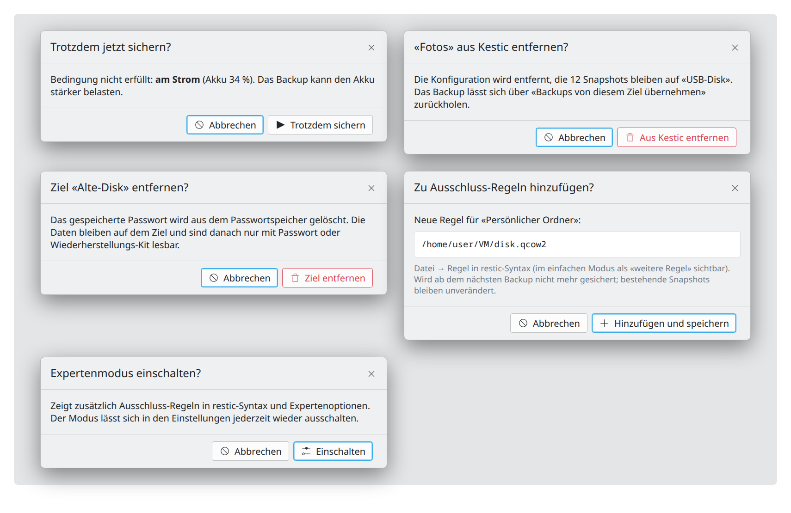

# GUI Stil und Texte

Teil von [index.md](index.md) (§11–§13). Verbindlichkeit, Referenz-Datensatz (§0.2) und Notation (§0.3): [index.md](index.md). Bilder sind Mockups, nicht normativ.

## 11. Theming und Systemintegration

### 11.1 Farben

- Nur `Kirigami.Theme`, keine Hex-Werte. Color-Sets setzen Kirigami-Komponenten selbst (`View` für Listen/Formulare, `Window` für Seiten, `Header` für Kopfleisten).
- Semantik gemäss HIG: `highlightColor` (Auswahl), `neutralTextColor`/`neutralBackgroundColor` (Warnung, nicht-Default), `negativeTextColor`/`negativeBackgroundColor` (Fehler, überfällig, gefährliche Aktion, Gefahrenbereich), `positiveTextColor` (nur Icons/Akzente bei ok). Statustext sonst `textColor` (Kontrast, §6.2).
- Hell/Dunkel und Akzentfarbe folgen dem Plasma-Farbschema (Referenzsystem: Breeze Dunkel **[verifiziert: Referenzsystem]**). Screenshots in Breeze, Breeze Dunkel, Breeze Hoher Kontrast (U16).

### 11.2 Schrift, Abstände, Animation

- System-Schrift; Überschriften nur `Kirigami.Heading`; Monospace (Pfade, Befehle, Logs, Regeln, Passphrase) `Kirigami.Theme.fixedWidthFont`; Hilfetexte `Kirigami.Theme.smallFont`.
- Abstände nach HIG-Tabelle: zusammengehörig `smallSpacing`, Gruppen `largeSpacing`, Toolbar `mediumSpacing`, Seitenrand `largeSpacing`, feste Grössen in `gridUnit`. Icons: Toolbar/Listen ohne Untertitel `iconSizes.smallMedium`, Listen mit Untertitel `iconSizes.medium`, Menüs `iconSizes.small`.
- Animationen nur mit `Kirigami.Units.*Duration`.
- RTL: Layouts über Anker/Qt-Layouts, Richtungs-Icons `-rtl`, Test mit `LANGUAGE=ar_AR` (Screenshot).

### 11.3 Icons

- Nur Theme-Namen, keine gebündelten Pixmaps (HIG). Verwendete Namen alle im Breeze-Thema vorhanden **[verifiziert: Referenzsystem]**: `alarm-symbolic`, `application-menu`, `backup`, `chronometer`, `dashboard-show`, `dialog-password`, `document-edit`, `document-export`, `document-print`, `document-revert`, `drive-harddisk`, `drive-removable-media`, `edit-copy`, `edit-delete`, `edit-find`, `emblem-important`, `emblem-ok-symbolic`, `folder`, `folder-cloud`, `folder-sync`, `media-playback-pause`, `media-playback-start`, `network-connect`, `network-disconnect`, `network-server`, `object-locked`, `process-stop`, `security-high`, `state-error`, `state-information`, `state-offline`, `state-ok`, `state-pause`, `state-sync`, `state-warning`, `user-home`, `utilities-terminal`, `vcs-diff`, `view-history`, `view-preview`.
- Bedeutung fest: `state-ok` nur für den Backup-Status «Gesichert»; «Erreichbar» = `network-connect`, «Kit vorhanden» und «Passwort stark» = `security-high`, «Behalten» in Vorschauen = `emblem-ok-symbolic`.
- **App-Icon:** eigenes farbiges Icon im Breeze-Stil (SVG, ab 32 px farbig, 48 px Raster), CC-BY-SA-4.0 ([decisions.md](../decisions.md) (Name und Lizenz)). Tray-Icon monochrom (16/22 px). Einzige eigene Grafiken.

### 11.4 Systemintegration

| Thema | Umsetzung |
| --- | --- |
| Datei-/Ordnerauswahl | KDE-Dateidialog (Portal), Start `~`, nur lokale Pfade |
| Ordner öffnen | `Qt.openUrlExternally(file://…)` → Dolphin |
| Fehlende Programme | `appstream://<id>` → Discover |
| Systemeinstellungen | Autostart- und Benachrichtigungs-Modul direkt öffnen **[verifiziert (M0-S11): `kcm_autostart`, `kcm_notifications`]** |
| Ruhezustand | Inhibit über Portal sichtbar in Plasma (F9) |
| Task-Manager | Prozent bei manuell gestartetem Lauf (FR-54, P2) |

## 12. Texte

### 12.1 Stil

- Neutral formulieren; wo eine Anrede unvermeidbar ist, Sie-Form wie in KDE-Übersetzungen (U10).
- EN: *Title Case* für Knöpfe, Menüeinträge, Tabs, Fenster-/Seitentitel; *Sentence case* für Sätze, Labels, Checkboxen, Radios, Tooltips, Statusmeldungen, Platzhalter.
- Knöpfe: Imperativ mit Verb («Jetzt sichern», «Kit erzeugen»), keine «OK/Ja/Nein» bei Entscheidungen; Dialogtitel mit Verb bzw. als Frage («Sperre aufheben?»).
- «…» nur, wenn vor der Wirkung weitere Eingaben nötig sind; Knopf mit Popup-Menü mit «▾».
- Einheiten ausgeschrieben («4 Minuten 12 Sekunden»); Abkürzungen nur bei Platzmangel (Listen, Tray). Zahlen/Grössen über Locale. Plural über `i18ncp`. 50 % Textwachstum einplanen.
- Im einfachen Modus keine restic-Wörter: «Aufräumen» statt `prune`, «Prüfen» statt `check`, «Ausnahme» statt Negation, «Sperre» statt Lock; restic-Begriffe in Klammern nur im Expertenmodus. «Snapshot» bleibt (Glossar).
- **Quellsprache der Strings (msgid) ist Englisch**; Deutsch kommt aus der `.po`-Datei (U11). Die deutsche Übersetzung folgt der KDE-Übersetzungspraxis (de_DE) **[angenommen]**; die Spec ist DE-CH.
- Glossar-Treue: «Fortschrittsanzeige» (nicht «Job»), «Zu Ausschluss-Regeln hinzufügen» (nicht «Auslassen/Ignorieren»), «Kit erzeugen» (nicht «erstellen»), «Jetzt sichern» (nicht «Backup starten»), «Passwortspeicher» (KWallet bzw. Secret Service), «Systemabschnitt» (Plasma-Begriff für den System-Tray, nicht für einen Einstellungsbereich), «Lauf» (nicht «Vorgang»). **Einstellungen:** Der Menüeintrag heisst nach KDE-Standardaktion «Kestic einrichten…» (EN «Configure Kestic…»), das Fenster trägt denselben Titel; im Text dieser Spec heisst es «Einstellungen».

### 12.2 Kerntexte (msgid EN / DE)

| Schlüssel | EN (msgid) | DE |
| --- | --- | --- |
| nav.overview | Overview | Übersicht |
| nav.restore | Restore | Wiederherstellen |
| nav.backups | Backups | Backups |
| nav.destinations | Destinations | Ziele |
| nav.history | History | Verlauf |
| action.backup_now | Back Up Now | Jetzt sichern |
| action.backup_all_now | Back Up All Now | Alle jetzt sichern |
| action.pause | Pause | Pausieren |
| action.resume | Resume | Fortsetzen |
| action.restore_selection | Restore Selection… | Auswahl wiederherstellen… |
| action.restore_now | Restore Now | Jetzt wiederherstellen |
| action.new_backup | New Backup… | Neues Backup… |
| action.add_destination | Add Destination… | Ziel hinzufügen… |
| action.cancel_run | Cancel | Abbrechen |
| action.show_command | Show Command | Befehl anzeigen |
| action.copy_command | Copy Command | Befehl kopieren |
| action.create_kit | Create Recovery Kit… | Wiederherstellungs-Kit erzeugen… |
| action.update_saved_password | Update Saved Password… | Gespeichertes Passwort aktualisieren… |
| action.release_lock | Release Lock… | Sperre aufheben… |
| action.add_to_excludes | Add to Exclude Rules… | Zu Ausschluss-Regeln hinzufügen… |
| action.quit_daemon | Quit Kestic… | Kestic beenden… |
| action.remove_backup | Remove from Kestic… | Aus Kestic entfernen… |
| action.configure | Configure Kestic… | Kestic einrichten… |
| danger.title | Danger Zone | Gefahrenbereich |
| danger.delete_backup | Delete Backup Completely… | Backup komplett löschen… |
| status.all_ok | All data backed up | Alle Daten gesichert |
| status.n_waiting | %1 of %2 backups waiting | %1 von %2 Backups wartet/warten |
| status.overdue | Overdue for %1 days | Überfällig seit %1 Tagen |
| quit.confirm | Scheduled backups will not run until Kestic is started again. | Geplante Backups laufen erst wieder, wenn Kestic gestartet ist. |
| close.hint | Kestic keeps backing up in the background. | Kestic sichert weiter im Hintergrund. |
| kit.stored | Recovery kit stored safely | Wiederherstellungs-Kit sicher aufbewahrt |

Gründe für «Wartet» siehe §6.3. Vollständige Texte entstehen mit den Screens (M1-S16); dieses Set ist verbindlich für Begriffe.

### 12.3 Destruktive Aktionen (NFR-08, AC-M6-09-1, HIG)

Undo nur, wo es wirklich alles zurückholt; alles andere mit Vorschau und Bestätigung.

| Aktion | Muster |
| --- | --- |
| Ordner aus Ausschluss-Liste entfernen, Filter, Regel im Editor | im Editor bis zum Speichern umkehrbar; kein Dialog |
| **Backup aus Kestic entfernen** (FR-56; Konfiguration weg, Snapshots und Metadaten bleiben im Ziel) | `PromptDialog` «‹Fotos› aus Kestic entfernen?» – «Die Konfiguration wird entfernt, die 12 Snapshots bleiben auf ‹USB-Disk›. Das Backup lässt sich über ‹Backups von diesem Ziel übernehmen› zurückholen.» `[Abbrechen]` `[Aus Kestic entfernen]` (AC-M1-19-2). Kein Undo |
| **Ziel entfernen** | kein Undo: `PromptDialog` «Ziel ‹Alte-Disk› entfernen?» – «Das gespeicherte Passwort wird aus dem Passwortspeicher gelöscht. Die Daten bleiben auf dem Ziel und sind danach nur mit Passwort oder Wiederherstellungs-Kit lesbar.» `[Abbrechen]` `[Ziel entfernen]` |
| Aufbewahrung speichern, die Snapshots entfernt (P10); Aufräum-Zeitplan aktivieren/ändern; «Wartung jetzt ausführen» | `PromptDialog` mit Vorschau (Anzahl je Backup, Liste aufklappbar) |
| Restore mit Überschreiben | Pflicht-Vorschau im Dialog, Knopf «Überschreiben und wiederherstellen» |
| Kit erneuern, Key entfernen (F7) | `PromptDialog` mit Folge («Das bisherige Kit wird ungültig.») |
| Gefahrenbereich: Backup komplett löschen (FR-48, P3) | nur im abgesetzten Abschnitt am Seitenende; Vorschau der Snapshots; Bestätigung durch Eintippen des Backup-Namens |

- Für alle `PromptDialog`s: Folge im Text, Knopf mit konkretem Verb in negativem Stil, Icon `edit-delete` wo Daten verschwinden, **Abbrechen ist Default** (Enter/Escape bricht ab). Undo-Frist für `showPassiveNotification` (harmlose Fälle): 10 Sekunden.
- **Begriffe:** «entfernen» betrifft nur die Konfiguration in Kestic (Backup, Ziel, Regel; Snapshots bzw. Repo bleiben, FR-56); «komplett löschen» entfernt Daten im Ziel und kommt nur im Gefahrenbereich vor (FR-48). Entfernen hat einen Bestätigungsdialog mit klarer Folge, ohne Vorschau und ohne Rückgängig.

## 13. Tastatur und Barrierefreiheit (NFR-09, P28)

### 13.1 Tastenkürzel

Standardaktionen über `KStandardShortcut`; Kürzel nie nur Funktionstaste (HIG), F-Tasten nur zusätzlich; keine Meta-Kürzel. Alle Kürzel unter «Tastenkürzel einrichten…» änderbar (Editor nach dem MVP, [nach-mvp.md](../milestones/nach-mvp.md)); «Handbuch» (F1) kommt mit M6-S13.

| Aktion | Kürzel |
| --- | --- |
| Neues Backup | Ctrl+N |
| Suchen | Ctrl+F |
| Aktualisieren | Ctrl+R (zusätzlich F5) |
| Kestic einrichten (Einstellungen) | Ctrl+Shift+, |
| Handbuch | F1 (Standard) |
| Ziel 1–5 der Navigation | Alt+1 … Alt+5 |
| Zurück | Alt+← |
| Umbenennen | F2 (zusätzlich ⋮ «Umbenennen…») |
| Jetzt sichern (gewähltes Backup = das im Backup-Detail gezeigte; ohne geöffnetes Backup, z. B. auf Übersicht oder Liste, ohne Wirkung) | Ctrl+Shift+B **[U12, Spike: Konflikte]** |
| Fenster schliessen | Ctrl+W, Ctrl+Q (beide nur GUI, §13.2) |

### 13.2 Fenster schliessen vs. Kestic beenden (U9)

Ctrl+Q und das Fenster-Kreuz beenden die **GUI**; der Daemon läuft weiter (getrennter Prozess, [architecture.md](../architecture.md) («Komponenten und Ausführung»)). Hinweis einmalig beim ersten Schliessen (§10.2) und dauerhaft in Einstellungen und Handbuch. Berührt K1.

### 13.3 Barrierefreiheit

- Jedes interaktive Element mit `Accessible.name`; Icon-only-Knöpfe mit Text (`display: IconOnly`) und Tooltip, auch bei Tastaturfokus (HIG). Status-Icons mit `Accessible.description` = Statustext.
- Vollständige Tab-Reihenfolge, sinnvoller Default-Fokus (z. B. «Jetzt sichern» im Backup-Detail, erstes Feld im Assistenten), Fokus ≠ Auswahl, Kontextmenü per Menü-Taste/Shift+F10.
- Eine Liste ist ein Tab-Halt, in der ganzen App: Tab führt auf ihren aktuellen Eintrag (beim ersten Mal den ersten), Hoch/Runter, Pos1/Ende und Bild auf/ab bewegen innerhalb, Leertaste setzt ein Kästchen, Enter öffnet, der nächste Tab bzw. Umschalt+Tab verlässt die Liste; Esc bleibt «eine Ebene zurück» (AC-M4-01-7). Ein Kontextmenü öffnet beim Drücken der rechten Maustaste an der Zeigerposition und ist nie der einzige Weg zu einer Aktion (HIG).
- Keine Information nur über Farbe (unterschiedliche Icons je Zustand, §6.2), nur im Tooltip oder nur in `showPassiveNotification`; keine gleichen Beschriftungen zweimal in einem Fenster.
- Fortschritt mit `Accessible.role: ProgressBar` und Textwert.
- Abnahme pro Screen (M6-S09): Tastatur-Durchlauf, Orca liest Status, Screenshot Hoher Kontrast und RTL.
