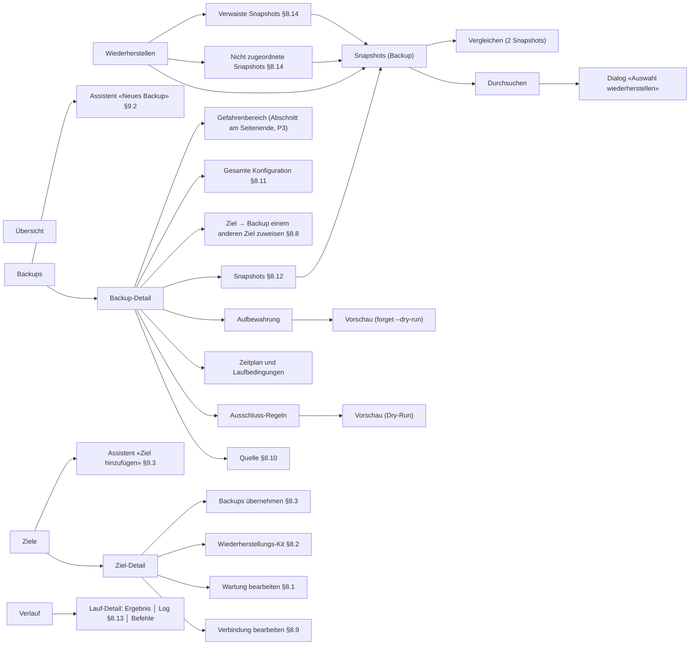
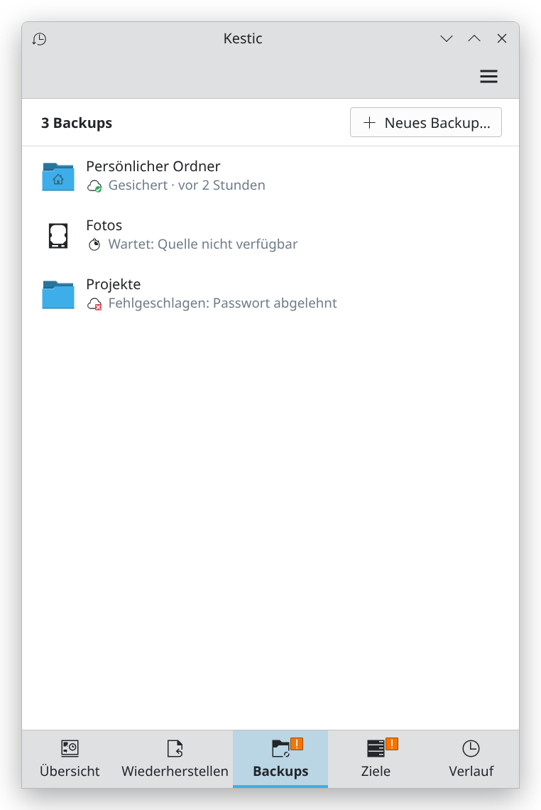
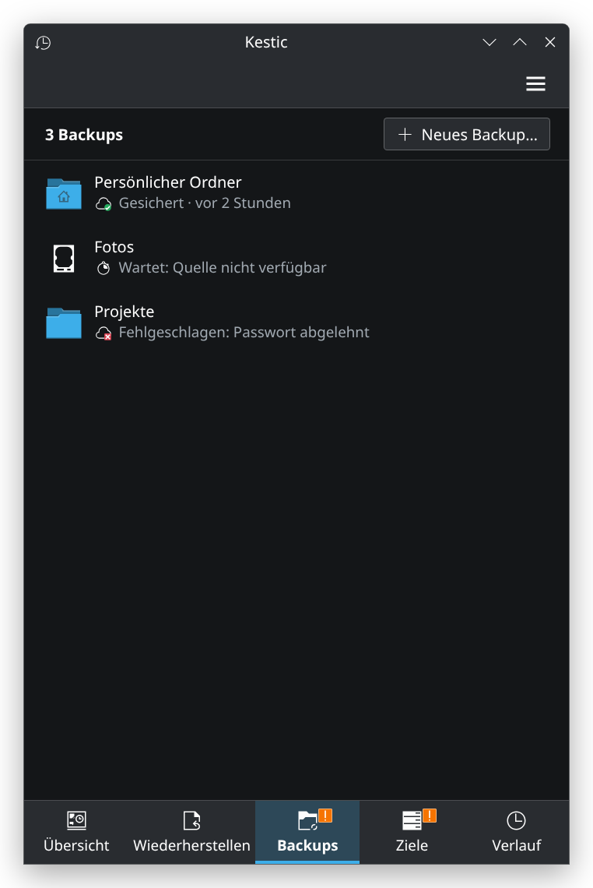

# GUI Struktur

Teil von [index.md](index.md) (§4–§5). Verbindlichkeit, Referenz-Datensatz und Notation: [index.md](index.md) §0. Bilder sind Mockups, nicht normativ.

## 4. Informationsarchitektur

### 4.1 Navigation (K3)

- **Tab-Leiste:** fünf nicht-lineare Ziele als `Kirigami.NavigationTabBar` über dem Inhalt (Desktop), unter dem Inhalt bei schmalem Fenster.
- **Innerhalb eines Ziels:** `pageStack` Liste → Detail (Spalten nebeneinander, wenn Platz; sonst gestapelt mit «Zurück»).
- **Hamburger-Menü:** Knopf `☰` (`application-menu`, Name «Hauptmenü» für Screenreader) am rechten Ende der obersten Kopfzeile, auf allen Seiten an derselben Stelle: breit rechts neben der Tab-Leiste, schmal (Tabs unten) allein in dieser Zeile; im Assistenten ausgeblendet. Ein Klick, Leertaste oder Enter öffnet das Menü darunter, Pfeiltasten wählen, Esc schliesst. Kirigamis eigener Menü-Knopf (`GlobalDrawer` mit `isMenu`) erscheint nur in der Seitenkopfleiste der ersten Seite, die Kestic zugunsten von Tab-Leiste und Breadcrumb ausblendet; daher ein eigener Knopf mit `Controls.Menu` (AC-M1-13-8).
- **Zustandsleiste** (§6.1) über den Tabs, nur wenn nötig.
- **Seitentitel:** Die fünf Hauptseiten haben keinen (Leitlinie 7). Detailseiten neben einer Liste tragen den Objektnamen («Persönlicher Ordner»). Tiefere Unterseiten zeigen statt eines Titels den Breadcrumb in der Kopfleiste («Backups › Persönlicher Ordner › Aufbewahrung»), nie beides. Assistenten tragen ihren Namen als Titel.
- **Fenstertitel** immer «Kestic» (auch mit Unterseiten und Assistenten); Einstellungsfenster «Kestic einrichten», Dialogfenster «Über Kestic».
- **Trennzeichen:** «›» nur im Breadcrumb und für Pfade in Snapshots; «·» nur zwischen Angaben in Untertiteln und Statuszeilen; «–» und «—» kommen in UI-Titeln nicht vor.
- **Tab-Embleme** (`emblem-important`): auf «Backups», wenn ein Backup Fehler hat oder überfällig ist; auf «Ziele», wenn ein Ziel ein Problem hat (Kit fehlt, gespeichertes Passwort passt nicht, Wartung fehlgeschlagen, veraltete Sperre). Auf allen Seiten gleich; keine Zahlen ohne Handlung.

Fensteraufbau von oben nach unten: Titelleiste («Kestic») · Zustandsleiste (optional) · Tab-Leiste mit `☰` am rechten Ende · Breadcrumb (ab der zweiten Ebene) · Spalten (Liste │ Detail mit Titel und Aktionen, `⋮`).

**Hamburger-Menü** (statisch, ≤ 15 Einträge, nicht passende deaktiviert, Einträge ohne umgesetztes Ziel fehlen, kein «Beenden» – den Daemon beendet nur das Tray, §9.5): Kestic einrichten… (Ctrl+Shift+,) · Über Kestic

Das Kürzel hängt an der Aktion des Menüs und wirkt auch bei geschlossenem Menü. Weitere Einträge kommen mit ihren Stories: «Konfiguration als Script exportieren…» (FR-24) mit M6-S07, «Handbuch» (F1) mit M6-S13; bis dahin erscheinen sie nicht. «Tastenkürzel einrichten…» steht in [nach-mvp.md](../milestones/nach-mvp.md). «Zeitpläne pausieren» steht nicht im Menü, sondern in der Fusszeile der Übersicht neben «Alle jetzt sichern» und im Tray (Leitlinie 7).

Keine Doppelbeschriftung (Leitlinie 7): «Alle jetzt sichern» steht nur in der Übersicht, «Neues Backup…» (Ctrl+N) nur im Listenkopf «Backups», «Ziel hinzufügen…» nur im Listenkopf «Ziele»; Ctrl+N wirkt überall.

| Ziel | Icon | Inhalt | FR |
| --- | --- | --- | --- |
| **Übersicht** (Startansicht) | `dashboard-show` | Gesamtstatus, Karte pro Backup, Hinweise | FR-12, FR-13a |
| **Wiederherstellen** | `document-revert` | Backup → Snapshot → Durchsuchen/Suchen → Wiederherstellen; nicht zugeordnete und verwaiste Snapshots | FR-06, FR-07, FR-10, FR-36, P20 |
| **Backups** | `folder-sync` | Liste → Backup-Detail → Editoren | FR-02–05, FR-13, FR-17, FR-28, FR-29, FR-31 |
| **Ziele** | `network-server` | Liste → Ziel-Detail (Verbindung, Wartung, Kit, Übernehmen) | FR-01, FR-11, FR-15, FR-19, FR-35, FR-45, FR-49 |
| **Verlauf** | `view-history` | alle Läufe → Lauf-Detail (Ergebnis, Log, Befehle) | FR-18, FR-34, FR-37, F4 |

### 4.2 Seitenhierarchie

Tiefe Seiten zeigen den Breadcrumb anstelle des Titels in der Kopfleiste (`pageStack.globalToolBar.style: Breadcrumb`) **[angenommen, Spike]**.

### 4.3 Fenstergrössen

- Standardgrösse ca. 65 × 41 `gridUnit` (≈ 1180 × 740 px), so dass deutsche Beschriftungen und zweispaltige Ansichten grosszügig Platz haben und keine Beschriftung abgeschnitten wird (HIG). Mindestgrösse ca. 26 × 24 `gridUnit`; Tab-Labels dürfen auch dort nicht abgeschnitten werden (Spike, §15).
- **Breit:** Liste + Detail nebeneinander. **Schmal:** eine Spalte, Tab-Bar unten, «Zurück» in der Kopfleiste. Ein Umbruchpunkt (35 Rastereinheiten) schaltet beides zugleich: Tab-Leiste und Spalten (AC-M4-01-9).
- Die Fenstergrösse wird unter `~/.local/state/kestic/` gemerkt und beim Start wiederhergestellt; die Position nur, wo die Plattform es erlaubt (nicht unter Wayland); ohne gespeicherten Wert gilt die Standardgrösse (AC-M6-28-4). F13 regelt dort nur die Ablage. **Entscheid offen** (#223): ob auch das aktive Ziel bzw. der aktive Tab gemerkt wird; bis dahin gibt es dafür keinen AC.

## 5. Bausteine

| Zweck | Komponente | Hinweis |
| --- | --- | --- |
| Fenster | `Kirigami.ApplicationWindow` | `pageStack`; Tab-Bar und Zustandsleiste im `header` bzw. `footer` |
| Navigation | `Kirigami.NavigationTabBar` mit `Kirigami.Action`s | K3 |
| Seiten | `Kirigami.ScrollablePage` | Titel nach §4.1 |
| Seitenaktionen | `Kirigami.Page.actions` | Hauptaktion zuerst, mit Icon + Text; Überlauf «⋮» automatisch |
| Formulare | **`Kirigami.FormLayout`** (Abschnitte über `Kirigami.FormData.isSection`) | HIG; kein FormCard (U2) |
| Datum/Uhrzeit | Kirigami Addons `dateandtime` | installiert **[verifiziert: Referenzsystem]**; neue Abhängigkeit (U2) |
| Tabellen | Kirigami Addons `tableview` | Vergleich, Vorschauen, Datei-Browser; neue Abhängigkeit (U2) |
| Listen | `ListView` mit Kirigami-Delegates, `section` für Datumsgruppen | Hinzufügen in `Kirigami.InlineViewHeader` |
| Leerzustände | `Kirigami.PlaceholderMessage` mit `helpfulAction` | jede Liste (§6.5) |
| Seiteninterne Hinweise | `Kirigami.InlineMessage` (seitenweit: `position: Header`) | Zustände mit Handlungsbedarf |
| Kurze Rückmeldung | `showPassiveNotification()` | Bestätigung, Undo bei Harmlosem |
| Dialoge | `Kirigami.Dialog`, `Kirigami.PromptDialog`, `Kirigami.MenuDialog` | nie zwei Kestic-Dialoge übereinander |
| Suche | `Kirigami.SearchField` | Snapshot-Suche (`find`), Verlauf |
| Filter | `Kirigami.Chip` (checkable) | Verlauf |
| Text | `Kirigami.Heading` (Level), `QQC2.Label` | kein `QtQuick.Text` |
| Fortschritt | `QQC2.ProgressBar` bzw. `Kirigami.LoadingPlaceholder` | ab 1 s Dauer; bestimmt, wenn bekannt |
| Datei-/Ordnerwahl | `QtQuick.Dialogs` `FolderDialog`/`FileDialog` → KDE-Dialog bzw. Portal `FileChooser` | nur lokale Pfade ([architecture.md](../architecture.md) («Onboarding und Ziel-Typen»)) |
| Code-Eingabe | `QQC2.TextArea` mit `Kirigami.Theme.fixedWidthFont`; optional `org.kde.syntaxhighlighting` | Ausschluss-Regeln im Expertenmodus |
| Über | `Kirigami.AboutPage` (in Kirigami enthalten **[verifiziert: Referenzsystem]**) | Daten aus `KAboutData` |

Keine `org.kde.plasma.*`-Komponenten (gehören zur Shell).
