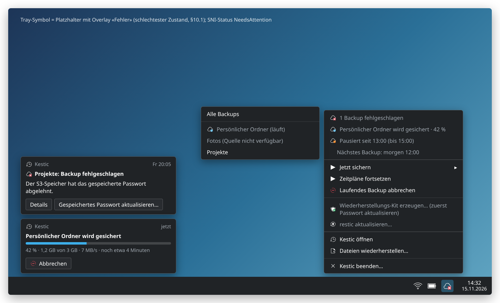

# GUI Tray und Benachrichtigungen

Teil von [index.md](index.md) (§10). Verbindlichkeit, Referenz-Datensatz (§0.2) und Notation (§0.3): [index.md](index.md). Bilder sind Mockups, nicht normativ.

## 10. Tray und Benachrichtigungen

### 10.1 Tray-Icon (StatusNotifierItem, K1)

- **Icon:** monochromes Symbol `kestic-symbolic` im Stil der Breeze-Status-Icons (16/22 px), Zustände per Overlay: läuft, Warnung, Fehler, überfällig, pausiert. Per Icon-Name, nicht als Pixmap. SVG mit Stylesheet-Klasse `ColorScheme-Text` **[verifiziert: Referenzsystem Plasma 6.6.6, Umfärbung hell/dunkel bei SNI mit eigenem `IconThemePath` wirkt]**.
- **Registrierung:** Der Tray-Eintrag besteht immer, solange der Daemon läuft; Kestic blendet ihn nie selbst aus und bietet keine Option dafür.
- **SNI-Status und Overlay** folgen dem Gesamtstatus (§6.2, schlechtester Zustand gewinnt), mit einer Ausnahme: **Ein Lauf oder eine Pause erzwingt mindestens `Active`**, auch wenn der Gesamtstatus «wartet» oder besser ist (K1, FR-13a, P14). `Passive` = Plasma zeigt den Eintrag im ausgeklappten Bereich des Systemabschnitts **[verifiziert: Referenzsystem Plasma 6.6.6]**.

| Gesamtstatus | SNI-Status | Overlay |
| --- | --- | --- |
| blockierender Zustand (§6.1) | `NeedsAttention` | Fehler |
| Fehler | `NeedsAttention` | Fehler |
| überfällig | `NeedsAttention` | überfällig (Wecker) |
| Warnung (Exit 3, Teilerfolg F4) | `Active` | Warnung |
| läuft (Backup, Restore, Wartung) | `Active` | läuft |
| pausiert (global oder ein Backup) | `Active` | pausiert |
| pausiert + ein anderes Backup wartet | `Active` | pausiert |
| wartet | `Passive` | keins (Grund im Tooltip und Menü) |
| unterbrochen | `Passive` | keins (nächster Lauf holt nach) |
| abgebrochen | `Passive` | keins |
| nie gelaufen, nur manuell, ok | `Passive` | keins |

- Läuft ein Lauf, während ein schlechterer Zustand besteht (z. B. Fehler), zeigt das Overlay den schlechteren Zustand; der Lauf steht in Tooltip, Menü und Fortschrittsanzeige (FR-53).
- **Tooltip:** «Kestic» + Gesamtstatus + «Nächstes Backup: morgen 12:00» bzw. «Persönlicher Ordner: 42 % · noch etwa 4 Minuten» (P5).
- **Linksklick:** `activateRequested` → Hauptfenster zeigen bzw. verbergen.
- **Menü** (vom Tray gerendert, statisch; nicht passende Einträge deaktiviert, nicht ausgeblendet):
  1. Gesamtstatus, z. B. «1 Backup fehlgeschlagen» (deaktiviert) · laufender Lauf, z. B. «Persönlicher Ordner wird gesichert · 42 %» · bei Pause «Pausiert seit 13:00 (bis 15:00)» · «Nächstes Backup: morgen 12:00» (alle deaktiviert)
  2. — Jetzt sichern ► Alle Backups — je Backup ein Eintrag (nicht verfügbare deaktiviert mit Grund, z. B. «Fotos (Quelle nicht verfügbar)»)
  3. Zeitpläne pausieren ► 1 Stunde · 3 Stunden · Bis morgen · Bis ich fortsetze — bzw. «Zeitpläne fortsetzen», wenn pausiert (Status «Pausiert seit …»)
  4. Laufendes Backup abbrechen (deaktiviert, wenn nichts läuft)
  5. — Wiederherstellungs-Kit erzeugen… (nur aktiv, wenn einem erreichbaren Ziel mit gültigem Passwort das Kit fehlt, sonst deaktiviert mit Grund, §8.2; öffnet GUI) · restic aktualisieren… (nur aktiv bei verfügbarem Update, F20; öffnet GUI)
  6. — Kestic öffnen · Dateien wiederherstellen… (aktiv, sobald ein Ziel eingerichtet ist, jeder Snapshot dort lässt sich wiederherstellen, auch ohne Kestic-Tag; ohne Ziel deaktiviert mit Grund «Dateien wiederherstellen… (kein Ziel verbunden)»; öffnet das Hauptfenster auf dem Tab «Wiederherstellen» wie «Kestic öffnen»; AC-M4-05-24)
  7. — Kestic beenden… (§9.5)
  8. — Versionszeile «Kestic 0.1.0 · a561018»: Version und kurzer Git-Hash des Daemons (ohne bekannten Hash nur die Version), aktiv; ein Klick öffnet «Über Kestic» in der GUI auf demselben Weg wie «Kestic öffnen» (offene GUI: Signal, sonst Start mit `--show-about`). Name und Nummern, in jeder Sprache gleich (AC-M1-11-6).

### 10.2 Benachrichtigungen (U17, FR-55)

- **MVP: Der Daemon sendet immer** gemäss F3 (AC-M1-11-4, AC-M3-08-1); die GUI zeigt dieselbe Information zusätzlich als `InlineMessage`. **P2 (FR-55):** Unterdrückt wird eine Benachrichtigung nur, wenn das Hauptfenster aktiv ist **und** genau die betroffene Seite zeigt (z. B. Backup-Detail desselben Backups), weil die HIG doppelte Meldungen im Blickfeld vermeidet. Technik: GUI meldet `WindowActive(bool, page)` an den Daemon (F14; M1-S09, `dbus-api.md`).
- Hint `desktop-entry` = App-ID → Plasma ordnet Name/Icon zu; die App erscheint unter Systemeinstellungen → Benachrichtigungen → Anwendungen mit «Popups», «Im Verlauf», «Bei Nicht stören» **[verifiziert: Referenzsystem: Optionen in `libnotificationmanager`]**. Zusätzlich `kestic.notifyrc` in `/usr/share/knotifications6/` (U6; Vorbild `kupdaemon.notifyrc` **[verifiziert: Referenzsystem]**). Ereignis-Filterung ohne KNotifications: **[geprüft im Spike M0-S11: wirkt nicht]** – `kestic.notifyrc` erscheint unter *Systemdienste → Kestic*, `desktop-entry` getrennt unter *Anwendungen → Kestic*; Ereignis-Schalter unterdrücken `notify-rust`-Popups nicht → F3-Schalter zusätzlich in Kestic (§9.6) zwingend.
- Ereignisse: `BackupFailed`, `BackupWarning`, `BackupOverdue`, `MaintenanceFailed`, `ResticUpdateAvailable`, `ManualRunBlocked` (FR-29/30), `RestoreFinished` (nur bei Fenster im Hintergrund).
- Inhalt: Titel = Backup-Name + Kurzstatus; Text = Satz nach §9.4; höchstens zwei Aktionen. «Details» öffnet bei Fehler/Warnung das Lauf-Detail, bei überfällig das Backup-Detail. Zweite Aktion: «Erneut versuchen» bzw. Handlung aus FR-37. Nie «Kestic beenden».
- Dringlichkeit (U7): Fehler und überfällig `Normal` + persistent; Warnung und Update `Normal`; nie `Critical`, nie `Low`.
- Keine Benachrichtigung bei Erfolg (F3, HIG) und bei «Wartet».
- **Einmaliger Hinweis beim ersten Schliessen** des Fensters (U9): Systembenachrichtigung «Kestic sichert weiter im Hintergrund.» ohne Aktion; dauerhaft steht der Hinweis in den Einstellungen und im Handbuch.

### 10.3 Fortschrittsanzeige im Benachrichtigungsbereich (FR-53, U5)

Plasma bietet `org.kde.JobViewServerV2.requestView(desktopEntry, capabilities, hints)` **[verifiziert: Referenzsystem, Interface vorhanden]**, in KDE als `KUiServerV2JobTracker` genutzt (Dolphin-Dateikopien). Ein Lauf erscheint damit im Benachrichtigungsbereich mit Fortschritt, Geschwindigkeit, Restzeit und «Abbrechen» – der von der HIG bevorzugte Weg für Fortschritt und wegen K1 der Weg, einen laufenden Lauf sichtbar zu machen (FR-53, MVP, M3). Ansteuerung aus Rust via `zbus` **[verifiziert: Referenzsystem Plasma 6.6.6, erfordert dauerhafte D-Bus-`Connection` im Handle]**.

Solange restic Dateien sucht (Phase `scanning`), meldet Kestic `percent` 0, keine Mengen (`processedBytes` und `totalBytes` 0) und keine Geschwindigkeit, damit Plasma einen Balken ohne festen Endpunkt zeigt **[Annahme aus `plasma-workspace` `JobItem.qml`, manuelle Abnahme]**; der Text ist derselbe wie die Überschrift («Persönlicher Ordner: sichert · Dateien werden durchgesehen»). Nach der Suche meldet Kestic Prozent, Mengen und Geschwindigkeit wie bisher.
