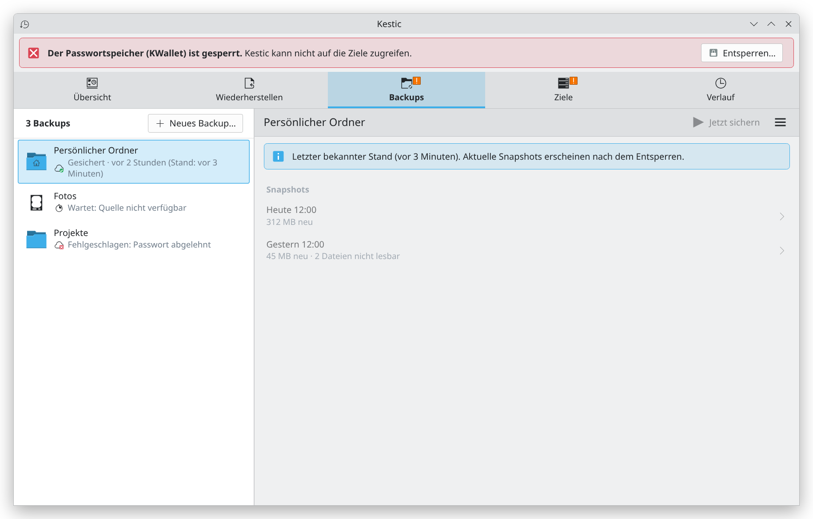

# GUI Zustände

Teil von [index.md](index.md) (§6). Verbindlichkeit, Referenz-Datensatz und Notation: [index.md](index.md) §0. Bilder sind Mockups, nicht normativ.

## 6. Zustände

### 6.1 Blockierende Zustände (Zustandsleiste)

Die GUI prüft beim Start (Selbsttest) und laufend, **in dieser Reihenfolge**. Der erste nicht erfüllte Zustand erscheint als `InlineMessage` (Error, `position: Header`) in der Zustandsleiste über den Tabs, mit Aktion. Solange er besteht, sind betroffene Aktionen deaktiviert (Tooltip nennt den Grund); Anzeigen aus dem letzten bekannten Stand bleiben lesbar und sind als «Stand: vor n Minuten» markiert.

| # | Zustand | Text (DE) | Aktion | betroffen |
| --- | --- | --- | --- | --- |
| 1 | Keine Verbindung zum Hintergrunddienst (D-Bus) | «Der Hintergrunddienst läuft nicht. Geplante Backups finden nicht statt.» | `[Hintergrunddienst starten]` | alles |
| 2 | Passwortspeicher gesperrt oder nicht erreichbar ([architecture.md](../architecture.md) («Secrets»), M6-S11) | «Der Passwortspeicher (KWallet) ist gesperrt. Kestic kann nicht auf die Ziele zugreifen.» | `[Entsperren…]` (löst die KWallet-Abfrage aus) | Läufe, Restore, Verbindungstests |
| 3 | restic fehlt oder ist älter als 0.18.0 (NFR-05, FR-33) | «restic 0.16.4 ist zu alt, Kestic braucht mindestens 0.18.0.» | `[restic herunterladen…]` (Download erst nach Klick, P23), `[Einstellungen]` | Läufe, Restore, Assistent ab Schritt 3 |

Nicht blockierend, ebenfalls in der Zustandsleiste (Warning bzw. Information, eine Zeile): **globale Pause** («Zeitpläne pausiert seit 13:00, bis 15:00» `[Fortsetzen]`), **Metadaten ausstehend** (FR-49). Der Assistent prüft 1–3 vor Schritt 3 und zeigt denselben Hinweis.

### 6.2 Backup-Zustände

Eine Abbildung für Fenster, Tray, Benachrichtigung. Immer Icon **und** Text, Farbe nur zusätzlich (HIG). Text in Listen als zweite Zeile, nie nur Icon.

| Zustand | Text DE / EN | Icon (Breeze) | Farbe des Icons (`Kirigami.Theme`) | Benachrichtigung |
| --- | --- | --- | --- | --- |
| ok | Gesichert · vor 2 Stunden / Backed up · 2 hours ago | `state-ok` | positiv | nein |
| läuft | Wird gesichert · 42 % / Backing up · 42% | `state-sync` | Highlight | Fortschrittsanzeige (FR-53) |
| ausstehend | Wartet: ‹Grund› / Waiting: ‹reason› (§6.3) | `chronometer` | Text | nein (Alert erst bei überfällig) |
| Warnung: Dateien nicht lesbar (Exit 3) | Gesichert, 2 Dateien nicht lesbar / Backed up, 2 files unreadable | `state-warning` | neutral | ja (F3) |
| Warnung: Teilerfolg (F4) | Gesichert, Aufbewahrung nicht ausgeführt / Backed up, retention not applied | `state-warning` | neutral | ja |
| Fehler | Fehlgeschlagen: ‹Ursache› / Failed: ‹cause› | `state-error` | negativ | ja |
| überfällig | Überfällig seit 3 Tagen / Overdue for 3 days | `alarm-symbolic` | negativ | ja |
| pausiert | Pausiert seit 13:00 (bis 15:00) / Paused since 13:00 (until 15:00) | `state-pause` | Text | nein |
| abgebrochen | Abgebrochen / Cancelled | `process-stop` | Text | nein |
| unterbrochen | Unterbrochen (Ruhezustand) / Interrupted (sleep) | `state-offline` | Text | nein; nächster Lauf holt nach |
| nie gelaufen | Noch nicht gesichert / Not backed up yet | `state-information` | Text | nein |
| nur manuell | Nur manuell · zuletzt vor 5 Tagen / Manual only · last 5 days ago | `state-information` | Text | nein |
| nur manuell, Quelle bzw. Ziel nicht verfügbar | Nur manuell · Ziel nicht erreichbar / Manual only · Destination unreachable | `state-information` | Text | nein; «Jetzt sichern» deaktiviert mit Grund (FR-30). Ein Backup «nur manuell» wird nie fällig und «wartet» daher nie (Entscheid 2026-11-20) |

- **Gewählte Zeile in Listen** (Backups, Ziele, Verlauf): Texte in `highlightedTextColor`, kein zusätzlicher Farbschleier über dem Inhalt; der Fokus ist ein Rahmen (Entscheid 2026-11-20, Befund der Abnahme M3: helle Auswahl im dunklen Theme war unlesbar).
- **Statustext immer in `textColor`**, nur das Icon ist farbig: `neutralTextColor` und `negativeTextColor` erreichen auf hellem Breeze-Hintergrund weniger als 4,5:1 Kontrast **[geschätzt, mit Breeze Hoher Kontrast prüfen]**. `disabledTextColor` nur für tatsächlich deaktivierte Elemente.
- Alle Icons im Breeze-Thema vorhanden **[verifiziert: Referenzsystem]**.
- **Gesamtstatus** (Übersicht, Tray) = schlechtester Einzelstatus: Fehler > überfällig > Warnung > läuft > wartet > pausiert > unterbrochen > abgebrochen > nie gelaufen > nur manuell = ok. Ausnahme für das Tray: Ein Lauf oder eine Pause erzwingt mindestens `Active`, bei «pausiert + wartet» zeigt das Overlay «pausiert» (§10.1). Text nennt die Anzahl: «Alle Daten gesichert» nur, wenn **alle** Backups ok sind; sonst z. B. «1 Backup fehlgeschlagen», «1 von 3 Backups wartet».
- Zeitangaben relativ («vor 2 Stunden»), Tooltip mit absolutem Datum im Locale-Format (`Qt.locale()`).

### 6.3 Gründe für «Wartet» ([domain-model.md](../domain-model.md), AC-M3-02-1)

| Grund (Code) | DE | EN |
| --- | --- | --- |
| `on_battery` | Wartet: am Strom | Waiting: AC power |
| `no_network` | Wartet: Netzwerk | Waiting: network |
| `metered` | Wartet: keine getaktete Verbindung | Waiting: unmetered connection |
| `wrong_network` | Wartet: erlaubtes Netzwerk | Waiting: allowed network |
| `source_unavailable` | Wartet: Quelle nicht verfügbar | Waiting: source unavailable |
| `destination_unreachable` | Wartet: Ziel nicht erreichbar | Waiting: destination unreachable |
| `queue` | Wartet: anderer Lauf auf diesem Ziel | Waiting: another run on this destination |
| `backoff` | Wartet: nächster Versuch um 14:20 | Waiting: next attempt at 2:20 PM |

- Schema: «Wartet: ‹was fehlt›» / «Waiting: ‹what is missing›», einheitlich in GUI, Tray und Verlauf.
- **Rangfolge bei mehreren Gründen:** Quelle nicht verfügbar > Ziel nicht erreichbar > Laufbedingung (Strom > Netzwerk > getaktet > erlaubtes Netzwerk) > Warteschlange > Backoff. Angezeigt wird der erste Grund, im Tooltip alle. In der Ansicht «Wiederherstellen» zählt nur das Ziel (dort liegen die Snapshots).

### 6.4 Ziel-Zustände

| Zustand | Text DE | Icon |
| --- | --- | --- |
| erreichbar | Erreichbar · zuletzt geprüft vor 5 Minuten | `network-connect` |
| nicht erreichbar | Nicht erreichbar (Netzwerk) | `network-disconnect` |
| Laufwerk nicht eingesteckt | Laufwerk nicht eingesteckt | `drive-removable-media` + Text |
| Passwort abgelehnt | Gespeichertes Passwort passt nicht | `state-error` |
| gesperrt | Gesperrt durch einen anderen Lauf | `object-locked` |
| veraltete Sperre (FR-19, P16) | Sperre eines unterbrochenen Laufs | `object-locked` + `[Sperre aufheben…]` |
| Wartung läuft | Wartung läuft · 30 % | `state-sync` |
| Wartung fehlgeschlagen | Wartung fehlgeschlagen: ‹Ursache› | `state-error` |
| Kit fehlt | Kein Wiederherstellungs-Kit | `emblem-important` |
| Metadaten ausstehend (FR-49) | Backup-Beschreibung wird beim nächsten Kontakt gespeichert | `state-information` |

### 6.5 Zustandsmatrix je Screen

| Screen | leer | lädt | offline / nicht verfügbar | Fehler |
| --- | --- | --- | --- | --- |
| Übersicht | Willkommen + «Erstes Backup einrichten» (§9.1) | `LoadingPlaceholder` beim ersten Abruf vom Daemon | Zustandsleiste #1 | Zustandsleiste |
| Backups | `PlaceholderMessage` «Noch keine Backups» + `[Neues Backup…]` | – (lokale Daten) | – | – |
| Snapshots | «Noch keine Snapshots – das erste Backup steht aus» + `[Jetzt sichern]` | `LoadingPlaceholder` «Snapshots werden geladen…» | «Ziel nicht erreichbar» bzw. **«Laufwerk ‹USB-Disk› einstecken, um die Snapshots zu sehen»** mit Icon; letzte bekannte Liste grau mit «Stand: …» | `InlineMessage` Error nach §9.4 + `[Erneut versuchen]` |
| Durchsuchen | «Dieser Ordner ist im Snapshot leer» | `LoadingPlaceholder` pro Ordner (lazy) | wie Snapshots | wie Snapshots |
| Suche | «Keine Treffer für ‹…›» | `BusyIndicator` + `[Abbrechen]` | wie Snapshots | wie Snapshots |
| Ziele | `PlaceholderMessage` «Noch keine Ziele» + `[Ziel hinzufügen…]` | – | Ziel-Zustand (§6.4) | Ziel-Zustand |
| Verlauf | «Noch keine Läufe» | – | – | – |
| Vorschau (Dry-Run, forget) | «Nichts zu sichern» bzw. «Kein Snapshot würde entfernt» | `ProgressBar` + `[Abbrechen]`; läuft mit `--no-lock` (P41), also auch während eines Backups auf demselben Ziel | «Ziel nicht erreichbar – Vorschau nicht möglich» | `InlineMessage` Error |
